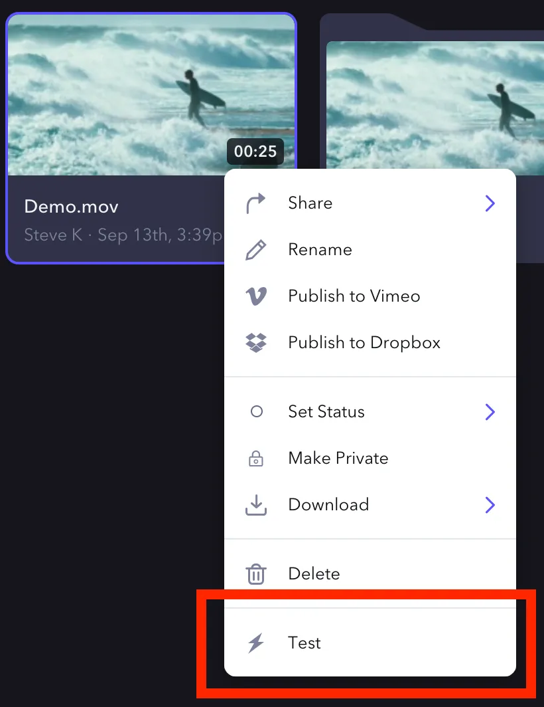
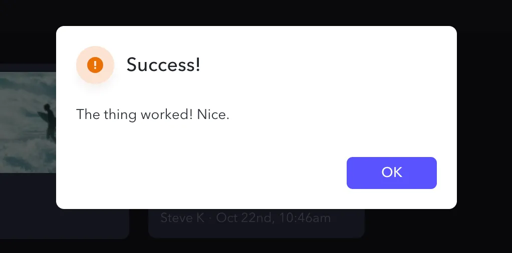
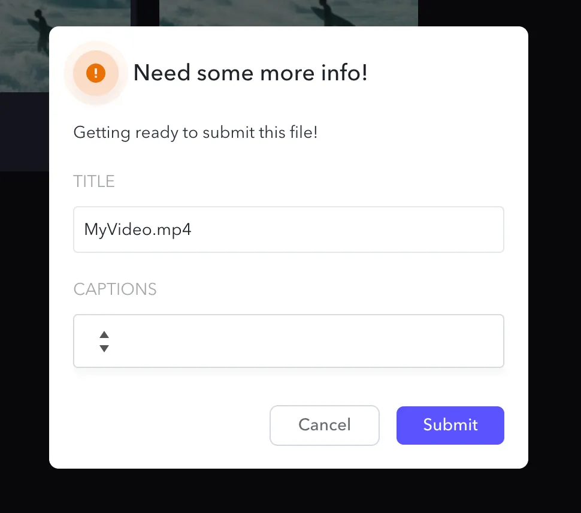

<Info>

**示例应用**

如果你想构建自己的 Custom Actions 应用，我们的示例应用可以帮助你快速上手：

</Info>

- [JavaScript](https://github.com/Frameio/custom-actions-example-app)
- [Python](https://github.com/Frameio/custom-actions-app-python)

Custom Actions 让你能够以可编程 UI 组件的形式，将集成直接构建到 Frame.io 中。这使得用户可以在应用内触发一整类工作流，并且它们使用与 [Webhooks](/cn/platform/v2/webhooks-overview) 相同的底层事件路由机制。目前，Custom Actions 适用于 Asset，并显示在任意 Asset 的上下文菜单（右键下拉菜单）中，如下图所示。



Asset 是对 S3 中某个文件及其在 Frame.io 中上下文的完整表示，其中包括转码文件、用户/团队/项目上下文以及元数据。当用户在某个 Asset 上点击 Custom Action 时，Frame.io 会向你提供的 URL 发送一个 payload。接收方应用随后可以仅返回一个 HTTP 状态码来确认收到，也可以返回一个自定义回调，在 Frame.io 中渲染额外的 UI。

## 设置你的 Custom Action {#setup-your-custom-action}

<Info>

**检查你的权限**

为团队创建 Custom Actions 需要 Team Manager 权限。如果你没有相应权限，请联系管理员修改你的权限。

</Info>

你可以在 [developer.frame.io](/cn/platform/v2) 的 [Custom Actions](https://developer.frame.io/actions) 区域中配置 Custom Actions。一个 Action 需要以下内容：

| 字段名称 | 描述 |
| --- | --- |
| Name | 你为 Custom Action 选择的名称。它将显示在 Frame.io 中可用 Custom Actions 的菜单里。 |
| Description | 说明该 Action 的用途，仅供参考（描述不会显示在 Frame.io Web 应用中）。 |
| Event | 内部事件键，用于帮助你区分标准 webhook 事件和你自己的事件。 |
| URL | 事件的投递地址。 |
| Team | 将使用该 Custom Action 的团队。 |

## 点击：你从 Frame.io 收到的 Payload 中包含什么 {#click-what’s-in-the-payload-you-receive-from-frame-io}

当用户点击你的 Custom Action 时，系统会向你在 URL 字段中指定的地址发送一个 payload。

```json
POST /your/url
{
  "action_id": "2444cccc-7777-4a11-8ddd-05aa45bb956b",
  "interaction_id": "aafa3qq2-c1f6-4111-92b2-4aa64277c33f",
  "project": {
    "id": "a7d6a74b-d45d-4019-9069-24651e0b9f64"
  },
  "resource": {
    "id": "9q2e5555-3a22-44dd-888a-abbb72c3333b",
    "type": "asset"
  },
  "team": {
    "id": "54353cd2-c6ee-4aa1-954a-ce9e19602aa9"
  },
  "type": "my.action",
  "user": {
    "id": "fb57eee0-79f2-4bc7-9b70-99fbc175175c"
  }
}
```

你可以使用此 payload 来识别：

- 你的哪个 Custom Action 被点击
- 哪个资源被点击
- 哪个用户执行了该操作

| 字段名称 | 描述 |
| --- | --- |
| `action_id` | 此 Action 的唯一 ID。对于同一个 Action，该值始终相同。 |
| `interaction_id` | 由 Frame.io 生成的唯一标识符，可用于跟踪你的事务。在一个 Action 的完整交互序列中（包括回调表单），该标识符都保持不变。 |
| `type` | 你在配置 Action 时在 Event 字段中填写的事件名称。 |
| `resource.id` | 触发 Action 的资源 ID（通常是 Asset）。 |
| `resource.type` | 触发 Action 的资源类型（通常为 *asset*） |

<Info>

**关于交互**

`interaction_id` 作为唯一标识符提供，帮助你在交互随时间推进的过程中对其进行跟踪。如果你不需要回复用户，只需返回 200 状态码即可。虽然这是可选的，但我们建议包含一些有关操作结果的信息，例如简单的成功消息或错误提示。Custom Actions 支持消息回调。

</Info>

<Info>

**重试与超时**

我们的应用期望在 5 秒内收到响应，并会在等待成功响应期间最多重试 5 次。理想情况下，你应立即响应，并在通过 Custom Action 触发后以异步方式执行所有操作。

</Info>

## 创建消息回调 {#create-a-message-callback}

在对 webhook 事件的 HTTP 响应中，你可以返回一个 JSON 对象来描述一条消息，该消息会在 Frame.io UI 中显示给发起操作的用户。如果你想尝试构建一条消息并查看其效果，可以使用我们的 [Custom Action Builder](https://next.frame.io/settings/actions)，它允许你设置消息回调或表单，并预览它们在 Frame.io Web 应用中的显示效果。

下面是一个示例对象：

```json
{
  "title": "Success!",
  "description": "The thing worked! Nice."
}
```

这将向用户显示如下所示的提示：


消息是一种简单的方式，可以为执行操作的用户提供相应的上下文，从而闭合 Action 的生命周期，而无需让用户切换上下文。

这足以满足许多用例，但有时初始 payload 以及后续对 Frame.io API 的调用无法为接收方应用提供足够的上下文。针对这些场景，我们还支持 **表单回调（Form Callbacks）**。

## 创建表单回调 {#create-a-form-callback}

假设你在开始处理之前需要更多信息。例如，你可能要将内容上传到一个需要额外详细信息和设置的系统。你可以在响应中"描述"一个表单，用户将真正看到它！填写它！然后它会被直接发送回给你！

下面是一个示例表单，它会在 Frame.io UI 中渲染一个表单，供最初执行操作的用户填写并提交：

```json
{
  "title": "Need some more info!",
  "description": "Getting ready to submit this file!",
  "fields": [
    {
      "type": "text",
      "label": "Title",
      "name": "title",
      "value": "MyVideo.mp4"
    },
    {
      "type": "select",
      "label": "Captions",
      "name": "captions",
      "options": [
        {
          "name": "Off",
          "value": "off"
        },
        {
          "name": "On",
          "value": "on"
        }
      ]
    }
  ]
}
```



当用户提交表单时，你会在与初始 POST 相同的 URL 上收到一个事件：

```json
POST /your/url​
{
  "type": "your-specified-event-name",
  "interaction_id": "the-same-id-as-before",
  "action_id": "unique-id-for-this-custom-action",
  "data":{
    "title": "MyVideo.mp4",
    "captions": "off"
  }
}
```

你在表单中添加的所有自定义字段都会出现在 Frame.io 发送的 JSON payload 的 `data` 部分中。

使用 `interaction_id` 将初始请求与这份新的表单数据对应起来。同样，如果你愿意，还可以回复一条消息（甚至另一个表单！）。

通过将 Actions、Forms 和 Messages 串联起来，你可以借助外部系统的业务逻辑，在 Frame.io 中有效地编排完整的 Asset 工作流。

尽情发挥想象力吧！一切皆有可能。

### 表单详情 {#form-details}

与消息一样，表单支持 `title` 和 `description` 属性，它们会显示在表单顶部。此外，每个表单字段都接受以下基本属性：

- `type` — 告诉 Frame.io UI 应预期哪种数据类型，以及要渲染哪个组件。
- `label` — 在 UI 中作为字段上方的标题显示。
- `name` — 在后续 payload 中用于标识该字段的键。
- `value` — 用于预填充该字段的值。

### 支持的字段类型 {#supported-field-types}

**文本字段**
一个简单的文本字段，无其他参数。

```json
{  
  "type": "text",
  "label": "Title",
  "name": "title",
  "value": "MyVideo.mp4"
}
```

**文本区域**
一个简单的文本区域，无其他参数。

```json
{  
  "type": "textarea",
  "label": "Description",
  "name": "description",
  "value": "This video is really, really popular."
}
```

**选择列表**
定义一个供用户选择的下拉列表。必须包含一个 `options` 列表，其中每个成员都应包含一个人类可读的 `name` 和一个机器可解析的 `value`。

```json
{
  "type": "select",
  "label": "Captions",
  "name": "captions",
  "value": "off",
  "options": [
       {
         "name": "Off",
         "value": "off"
       },
       {
         "name": "On",
         "value": "on"
      }
   ]
}
```

## Custom Actions 与 Frame.io 权限模型 {#custom-actions-and-the-frame-io-permissions-model}

Webhooks 和 Custom Actions 采用一种特殊的权限模型：它们属于某个 **Team（团队）**，而不属于团队或账户中的任何特定用户。这意味着：

- 任何 Admin 或 Team Manager 都可以在团队中创建 Custom Action。
- 任何 Admin 或 Team Manager 都可以修改或删除团队中已有的 Custom Action。修改后，所有用户都会立即看到更改结果。

## 安全性 {#security}

默认情况下，所有 Custom Actions 在创建时都会生成一个签名密钥。此项不可配置。该密钥可用于验证请求是否来自 Frame.io。

### 验证 {#verification}

`POST` 请求中包含以下内容

| 名称 | 描述 |
| --- | --- |
| `X-Frameio-Request-Timestamp` | 你的 Custom Action 被触发的时间。 |
| `X-Frameio-Signature` | 计算得出的签名。 |

**时间戳** 是请求离开 Frame.io 网络时被签名的时间，可用于防止重放攻击。我们建议验证该时间与本地时间的差值在 5 分钟以内。

**签名** 是一个 HMAC SHA-256 哈希值，使用 Custom Action 首次创建时提供的签名密钥生成。

#### 验证签名 {#verifying-the-signature}

1. 从 HTTP 标头中提取签名
2. 将版本、投递时间和请求体组合起来，创建待签名的消息

- `v0:timestamp:body`

3. 使用你的签名密钥计算 HMAC SHA256 签名。

- 注意：提供的签名带有 `v0=` 前缀。目前 Frame.io 仅有这一种用于签名请求的版本。你需要为自己计算出的签名添加此前缀。

4. 进行比较！

```python title="Python"
import hmac
import hashlib

def verify_signature(curr_time, req_time, signature, body, secret):
    """
    Verify webhook/custom action signature
    :Args:
        curr_time (float): Current epoch time
        req_time (float): Request epoch time
        signature (str): Signature provided by the frame.io API for the given request
        body (str): Custom Action body from the received POST
        secret (str): The secret for this Custom Action that you saved when you first created it
    """
    if int(curr_time) - int(req_time) < 500:
        message = 'v0:{}:{}'.format(req_time, body)
        calculated_signature = 'v0={}'.format(hmac.new(
            bytes(secret, 'latin-1'),
            msg=bytes(message, 'latin-1'),
            digestmod=hashlib.sha256).hexdigest())
        if calculated_signature == signature:
            return True
    return False
```
