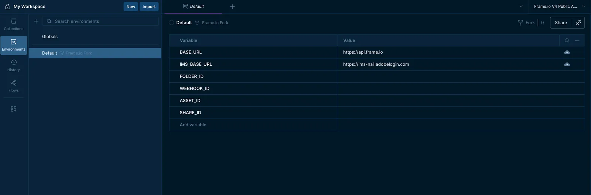
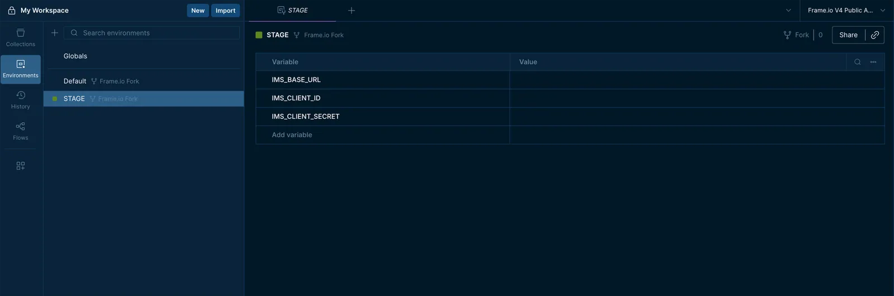
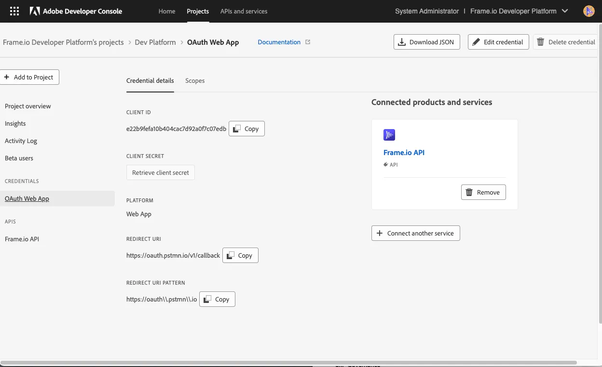
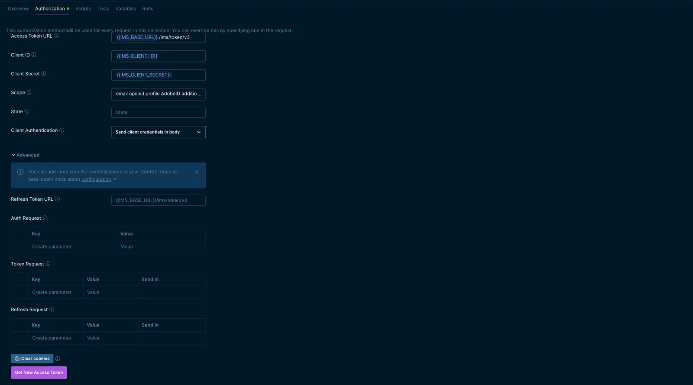
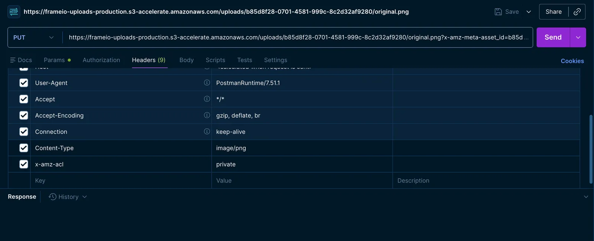

Dieser Leitfaden behandelt die Grundlagen der offiziellen Postman Collection der Frame.io Developer API, einer Sammlung vorgefertigter Requests, mit denen Sie den Einstieg in die Frame.io V4 API finden.

Die Collection deckt das gesamte Spektrum der V4-API-Endpoints ab, unterteilt in die Kategorien stabil und experimentell. Stabile Endpoints sind produktionsreif; experimentelle Endpoints sind neuere Ergänzungen, die zwar funktionsfähig sind, sich aber aufgrund von Feedback noch ändern können, bevor sie als stabil eingestuft werden.

## Erste Schritte mit Postman {#getting-started-with-postman}

<Tip>

Dieser Leitfaden setzt voraus, dass Sie bereits Zugangsdaten für die API generiert haben. Falls nicht, beginnen Sie zuerst [hier](/de/platform/docs/quick-start)

</Tip>

<Steps>

<Step title="Postman-Konto erstellen + Setup auswählen">

Erstellen Sie Ihr Postman-Konto auf [postman.com](http://auth.postman.com/__redirect/login) und wählen Sie Ihr Setup. Sie können die Postman-App [hier](https://www.postman.com/downloads/) herunterladen oder Postman im Web verwenden.

</Step>

<Step title="Postman Collection der Frame.io Developer API importieren">

<CardGroup cols={2}>

<Card title="Frame.io Developer API Collection" icon="terminal" iconType="solid" href="https://www.postman.com/adobe/workspace/frame-io-v4-public-api/collection/33150877-924315f2-cc62-45f5-8153-77ff2aaa9067?action=share&creator=33150877&active-environment=33150877-cffd66a8-23bd-4c50-8891-29157ead1185">

Hier forken oder herunterladen

</Card>

</CardGroup>

</Step>

</Steps>

### Ihre Umgebung einrichten {#setting-up-your-environment}

Die Frame.io Developer API Collection verfügt über eine Standard-<Tooltip tip="Eine Reihe von Variablen, auf die Sie beim Senden von Requests verweisen können. Weitere Informationen zu Umgebungen finden Sie in der Postman-Dokumentation **[hier](https://learning.postman.com/docs/sending-requests/variables/managing-environments)**">Umgebung</Tooltip>, in der eine Reihe von Umgebungsvariablen definiert ist. Die Werte von `BASE_URL` und `IMS_BASE_URL` sind statisch. Weitere Umgebungsvariablen können entsprechend Ihren Kontoinformationen konfiguriert werden.

<Frame>




</Frame>

Die folgende Tabelle beschreibt jede Variable in den Umgebungen Default und Stage der Collection:

| Variable | Beschreibung | Wo Sie sie erhalten | Umgebung |
| --- | --- | --- | --- |
| `BASE_URL` | Basis-URL für alle V4-API-Requests | Vorkonfiguriert, nicht bearbeiten | Default |
| `IMS_BASE_URL` | Basis-URL für die Adobe-IMS-Authentifizierung | Vorkonfiguriert, nicht bearbeiten | Default, Stage |
| `IMS_CLIENT_ID` | Die Client ID Ihrer Frame.io-App | Credential-Seite in der **[Adobe Developer Console](https://developer.adobe.com/developer-console/)** | Stage |
| `IMS_CLIENT_SECRET` | Das Client Secret Ihrer Frame.io-App | Credential-Seite in der **[Adobe Developer Console](https://developer.adobe.com/developer-console/)** | Stage |
| `FOLDER_ID` | Eindeutige ID des Zielordners | Wird im Folder-Response-Objekt zurückgegeben | Default |
| `WEBHOOK_ID` | Eindeutige ID eines konfigurierten Webhooks | Wird im Webhook-Response-Objekt zurückgegeben | Default |
| `ASSET_ID` | Eindeutige ID eines Datei- oder Ordner-Assets | Wird im File- oder Folder-Response-Objekt zurückgegeben | Default |
| `SHARE_ID` | Eindeutige ID eines Share-Links | Wird im Share-Response-Objekt zurückgegeben | Default |

---

### Autorisierung einrichten {#setting-up-authorization}

<Tip>

Dieser Leitfaden verwendet OAuth 2.0 zur Authentifizierung bei der Frame.io V4 API. Informationen zu anderen Authentifizierungsmethoden wie Server-to-Server (S2S) finden Sie im [Authentifizierungsleitfaden](/de/platform/docs/guides/authentication/overview).

</Tip>

Die Umgebungsvariablen `IMS_CLIENT_ID` und `IMS_CLIENT_SECRET` sollten auf die Werte gesetzt werden, die Sie unter **Credential details** Ihres Projekts in der [Adobe Developer Console](https://developer.adobe.com/console) abrufen.

<Frame>



</Frame>

Setzen Sie im Abschnitt **Credential details** Ihres Projekts die **Redirect URI** und das **Redirect URL Pattern** auf den öffentlichen Callback-Endpoint von Postman:

**Redirect URI**

```
https://oauth/pstmn.io/v1/callback
```

**Redirect URI Pattern**

```
https://oauth\\.pstmn\\.io
```

Sobald die Umgebungsvariablen gesetzt und gespeichert sind, besteht der nächste Schritt darin, die Autorisierungseinstellungen zu konfigurieren. Klicken Sie dazu oben in der linken Seitenleiste auf das Symbol **Collections**, um Ihren Collection-Browser zu öffnen.

Wählen Sie im Collection-Browser die Wurzel der Frame.io V4 Developer API Collection aus (in der Regel mit **‘Frame.io Developer API Collection’** gefolgt vom Namen Ihres Forks betitelt) und wählen Sie den Tab **Authorization**.


OAuth-<Tooltip tip="Weitere Informationen zu OAuth-Scopes finden Sie in der IMS-Dokumentation **[hier](https://developer.adobe.com/developer-console/docs/guides/authentication/UserAuthentication/ims#scopes)**">Scopes</Tooltip> sind in der Collection vorkonfiguriert. Nachdem Sie Ihre Umgebungsvariablen gesetzt haben, starten Sie den OAuth-2.0-Flow über die Schaltfläche **Get New Access Token**. Dadurch wird ein Browserfenster geöffnet, in dem Sie den Authentifizierungsprozess abschließen; anschließend wird das Token an Postman zurückgegeben.

Um Ihre Autorisierungskonfiguration zu überprüfen, wählen Sie im Ordner Users den Request **`GET user details`** aus und klicken Sie auf **Send**.

Eine **`200 OK`**-Antwort bestätigt sowohl, dass Ihre Collection korrekt konfiguriert ist, als auch, dass Sie sich beim richtigen Konto authentifiziert haben. Wenn ein Fehler auftritt, finden Sie in **[diesem Abschnitt](/de/platform/docs/getting-started#errors)** des Leitfadens „Erste Schritte“ Informationen zu Fehlern und Warnungen.

**Beispielantwort**

```
{
  "data": {
    "avatar_url": "https://assets.frame.io/uploads/cd58cb8e-24b3-4448-8d0f-9532fcd04d11/original.png?response-content-disposition=attachment%3B+filename%3D%22foo.png&Expires=1729857600&Signature=L09h0pi82dCrMYjr9lMHBragByWYh1&Key-Pair-Id=KKI497NESTHMN",
    "email": "user_email@example.com",
    "id": "00000000-1111-2222-3333-444444444444",
    "name": "Name"
  }
}
```

---

## Ihre Account ID abrufen {#obtaining-your-account-id}

`account_id` ist ein erforderlicher Pfadparameter für die meisten V4-API-Endpoints und wird benötigt, um weitere Requests zu testen. Sie können Ihre `account_id` mit dem Request **`GET List accounts`** im Ordner **Accounts** der Collection abrufen. **[API-Referenz](/de/platform/api-reference/accounts/index)**

**Beispielantwort**

```
{
  "data": [
    {
      "created_at": "2023-09-25T19:18:29.614189Z",
      "display_name": "Integration Account",
      "id": "11111111-2222-3333-4444-555555555555",
      "roles": [
        "admin"
      ],
      "storage_limit": 300,
      "storage_usage": 300,
      "updated_at": "2024-02-07T16:44:41.986478Z",
      "image": null
    }
  ],
  "links": {
    "next": "/v4/accounts"
  }
}
```

<Tip>

Wenn Sie mehrere Frame.io-Konten haben, erscheint jedes als separates Objekt in der Antwort

</Tip>

Sobald Sie Ihre Account ID erhalten haben, kopieren Sie den Wert `id` aus der Antwort und speichern Sie ihn als Umgebungsvariable. In künftigen Requests verweisen Sie darauf als `account_id`-<Tooltip tip="Weitere Informationen zum Senden von Request-Parametern finden Sie in der **[Postman-Dokumentation](https://learning.postman.com/docs/sending-requests/create-requests/parameters#send-request-parameters)**">Pfadparameter</Tooltip> mit `{{ACCOUNT_ID}}`.

---

## Workspace- und Project-Operationen {#workspace-and-project-operations}

Ihre Frame.io-Dateien werden in Ordnern gespeichert, die in Projects innerhalb von Workspaces organisiert sind. Einen vollständigen Überblick über die V4-Ressourcenhierarchie finden Sie in **[diesem Leitfaden](/de/platform/docs/getting-started#resource-hierarchy)**.

### Workspaces auflisten {#listing-workspaces}

Der Request **`GET list workspaces`** im Ordner **Workspaces** ruft **[`/v4/accounts/:account_id/workspaces`](/de/platform/api-reference/workspaces/index)** auf und gibt eine Liste der Workspaces zurück, auf die Ihr Konto Zugriff hat.

Einige Project-Operationen erfordern `workspace_id` als Pfadparameter. Speichern Sie daher zuerst Ihre Workspace ID, wenn Sie Projects auflisten oder abrufen möchten.

Ein erfolgreicher Request gibt den Status **`200 OK`** und einen Response-Body ähnlich dem folgenden Beispiel zurück.

**Beispielantwort**

```
{
  "data": [
    {
      "account_id": "11111111-2222-3333-4444-555555555555",
      "created_at": "2024-01-25T19:18:29.614189Z",
      "id": "88888888-bbbb-4444-aaaa-ffffffffffff",
      "name": "My Workspace",
      "updated_at": "2024-02-07T16:44:41.986478Z",
      "creator": {
        "active": true,
        "avatar_url": "https://assets.frame.io/uploads/cd58cb8e-24b3-4448-8d0f-9532fcd04d11/original.png?response-content-disposition=attachment%3B+filename%3D%22foo.png&Expires=1729857600&Signature=L09h0pi82dCrMYjr9lMHBragByWYh1&Key-Pair-Id=KKI497NESTHMN",
        "email": "user_email@example.com",
        "id": "196C1A5777BF4CV00A49411B@176719f5667d82g5594324.e",
        "name": "Name"
      }
    }
  ],
  "links": {
    "next": "/v4/accounts/123/workspaces"
  }
}
```

---

### Einen Workspace erstellen {#creating-a-workspace}

Der Request **`POST create workspace`** ruft **[`/v4/accounts/:account_id/workspaces`](/de/platform/api-reference/workspaces/create)** auf, um einen neuen Workspace für Ihr Konto zu erstellen.

Wählen Sie im Request-Editor den Tab **Body**, um den Namen Ihres Workspace im `data`-Objekt festzulegen.

Ein erfolgreicher Request gibt den Status **`201 Created`** und einen Response-Body ähnlich dem folgenden Beispiel zurück.

**Beispielantwort**

```
{
  "data": {
    "account_id": "11111111-2222-3333-4444-555555555555",
    "created_at": "2024-01-25T19:18:29.614189Z",
    "id": "77777777-999-4444-8888-000000000000",
    "name": "My New Workspace",
    "updated_at": "2024-02-07T16:44:41.986478Z"
  }
}
```

---

### Einen Workspace aktualisieren {#updating-a-workspace}

Der Request **`PATCH update workspace`** ruft **[`/v4/accounts/:account_id/workspaces/:workspace_id`](/de/platform/api-reference/workspaces/update)** auf, um den Namen eines Workspace zu ändern.

Wählen Sie im Request-Editor den Tab **Body**, um den neuen Namen Ihres Workspace im `data`-Objekt festzulegen.

Ein erfolgreicher Request gibt den Status **`200 OK`** und einen Response-Body ähnlich dem folgenden Beispiel zurück.

**Beispielantwort**

```
{
    "data": {
        "id": "77777777-9999-4444-8888-000000000000",
        "name": "New Workspace Name",
        "updated_at": "2026-05-01T02:42:00.462467Z",
        "account_id": "11111111-2222-3333-4444-555555555555",
        "created_at": "2025-09-22T19:17:02.565496Z"
    }
}
```

---

### Ein Project erstellen {#creating-a-project}

Der Request **`POST create project`** ruft **[`/v4/accounts/:account_id/workspaces/:workspace_id/projects`](/de/platform/api-reference/projects/create)** auf, um ein neues Project in einem bestimmten Workspace zu erstellen.

Wählen Sie im Request-Editor den Tab **Body**, um den Namen Ihres Project im `data`-Objekt festzulegen. Die optionale Eigenschaft `restricted` ist ein Boolean, mit dem ein eingeschränktes Project erstellt wird.

Ein erfolgreicher Request gibt den Status **`201 Created`** und einen Response-Body ähnlich dem folgenden Beispiel zurück.

**Beispielantwort**

```
{
    "data": {
        "id": "fd26defb-8bdf-5c39-9746-24d38f109cc3",
        "name": "test",
        "status": "active",
        "restricted": true,
        "updated_at": "2026-05-01T03:39:58.910884Z",
        "storage": 0,
        "workspace_id": "77777777-999-4444-8888-000000000000",
        "created_at": "2026-05-01T03:39:58.853797Z",
        "root_folder_id": "d4fca8b4-5fd8-4a94-90aa-de13de4b2021",
        "view_url": "https://next.frame.io/project/fd26defb-8bdg-5c39-9746-24d38f109cc3"
    }
}
```

Kopieren Sie die **`root_folder_id`** aus der Antwort und legen Sie sie als Wert Ihrer Umgebungsvariable **`FOLDER_ID`** fest. Sie benötigen sie für die übrigen Abschnitte dieses Leitfadens.

<Tip>

Mit einem anschließenden Request **`PATCH Update user role in a Project`** im Ordner **Project Permissions** können Sie einem neu erstellten eingeschränkten Project einen Benutzer hinzufügen. (**[API-Referenz](/de/platform/docs/guides/postman-collection)**)

</Tip>

---

## Ordner- und Dateioperationen {#folder-and-file-operations}

### Untergeordnete Elemente eines Ordners auflisten {#listing-folder-children}

Der Request **`GET list folder children`** ruft **[`/v4/accounts/:account_id/folders/:folder_id/children`](/de/platform/api-reference/folders/index)** auf, um die untergeordneten Elemente eines bestimmten Ordners aufzulisten – in diesem Fall des Project-Stammordners, den Sie als Umgebungsvariable **`FOLDER_ID`** festgelegt haben.

Mit den folgenden optionalen Query-Parametern können Sie Ihre Antwort eingrenzen:

| Parameter | Typ | Beschreibung |
| --- | --- | --- |
| **`page_size`** | Integer | Begrenzt die Anzahl der zurückgegebenen Ordner <br />**1–100. Standardwert 50** |
| **`type`** | String | Filtert untergeordnete Elemente nach Ressourcentyp: **`file`** oder **`folder`** |
| **`after`** | String | Opaker Cursor für Requests mit paginierten Ergebnissen. <br />**Dieser wird automatisch generiert und im `links`-Objekt der vorherigen Antwort zurückgegeben.** Er ist nicht dafür gedacht, von Menschen gelesen zu werden. |
| **`include_total_count`** | Boolean | Gibt die Gesamtzahl aller Entitäten zurück <br />**Standardwert False** |
| **`include`** | Enum | Fügt jedem zurückgegebenen Objekt zusätzliche Daten wie `creator`, `project`, `media_links` hinzu. <br />Eine vollständige Liste der unterstützten Parameter finden Sie in der **[API-Referenz](/de/platform/api-reference/folders/index#request.query.include)** |

Ein erfolgreicher Request gibt den Status **`200 OK`** und einen Response-Body ähnlich dem folgenden Beispiel zurück.

**Beispielantwort**

```
{
  "data": [
    {
      "type": "file",
      "created_at": "2023-09-25T19:18:29.614189Z",
      "file_size": 1137444,
      "id": "cba3b1c5-c644-4592-91c5-0d0b91f4895d",
      "media_type": "image/png",
      "name": "asset.png",
      "parent_id": "2559e2c4-9bb9-4284-b616-a97700a579a4",
      "project_id": "955c0511-656a-4859-b824-ebdbfdcb615b",
      "status": "created",
      "updated_at": "2024-02-07T16:44:41.986478Z",
      "view_url": "https://next.frame.io/project/d5e6011c-2bc9-4596-be05-77d562627112/view/5a89a9fb-0900-4b23-826b-127b90e4db4c",
      "creator": {
        "active": true,
        "avatar_url": "https://assets.frame.io/uploads/cd58cb8e-24b3-4448-8d0f-9532fcd04d11/original.png?response-content-disposition=attachment%3B+filename%3D%22foo.png&Expires=1729857600&Signature=L09h0pi82dCrMYjr9lMHBragByWYh1&Key-Pair-Id=KKI497NESTHMN",
        "email": "user_email@example.com",
        "id": "196C1A5666BF4EB00A49411B@176719f5667c82b4494214.e",
        "name": "Jon Doe"
      },
      "media_links": {
        "high_quality": {
          "download_url": "https://assets.frame.io/uploads/cd58cb8e-24b3-4448-8d0f-9532fcd04d11/original.png?response-content-disposition=attachment%3B+filename%3D%22foo.png&Expires=1729857600&Signature=L09h0pi82dCrMYjr9lMHBragByWYh1&Key-Pair-Id=KKI497NESTHMN"
        },
        "original": {
          "download_url": "https://assets.frame.io/uploads/cd58cb8e-24b3-4448-8d0f-9532fcd04d11/original.png?response-content-disposition=attachment%3B+filename%3D%22foo.png&Expires=1729857600&Signature=L09h0pi82dCrMYjr9lMHBragByWYh1&Key-Pair-Id=KKI497NESTHMN",
          "inline_url": "https://assets.frame.io/uploads/cd58cb8e-24b3-4448-8d0f-9532fcd04d11/original.png?response-content-disposition=inline%3B+filename%3D%22foo.png&Expires=1729857600&Signature=L09h0pi82dCrMYjr9lMHBragSDFXDFh&1Key-Pair-Id=KKI497NESTHMN"
        },
        "thumbnail": {
          "download_url": "https://assets.frame.io/uploads/cd58cb8e-24b3-4448-8d0f-9532fcd04d11/original.png?response-content-disposition=attachment%3B+filename%3D%22foo.png&Expires=1729857600&Signature=L09h0pi82dCrMYjr9lMHBragByWYh1&Key-Pair-Id=KKI497NESTHMN",
          "url": "https://picture2.frame.io/image/s3://frameio-assets-development/image/cd58cb8e-24b3-4498-8d0f-9532fcd04d11/image_full.png?alg=HS256&sig=0_u7w_wz2MwQHOXp000ibbQSMRijujyaUu8V3YYPxu4&exp=1729857600"
        }
      },
      "metadata": [
        {
          "field_type": "select",
          "field_definition_id": "b859ccec-9536-4bf2-bc6f-5e9206e26606",
          "field_definition_name": "Fields definition name",
          "mutable": true,
          "value": [
            {
              "display_name": "Display name",
              "id": "212add59-6527-4fd2-ac30-55ea94a8b5f8"
            }
          ],
          "field_options": [
            {
              "display_name": "Display name",
              "id": "212add59-6527-4fd2-ac30-55ea94a8b5f8"
            },
            {
              "display_name": "Display name 2",
              "id": "c6eb873f-125b-4317-b857-1a22eb3dbf22"
            }
          ]
        }
      ],
      "project": {
        "created_at": "2024-01-25T19:18:29.614189Z",
        "description": "Project Description",
        "id": "e0e30b1d-c3aa-44ee-926e-c6c326fb10dc",
        "name": "My Project",
        "root_folder_id": "be733511-6f15-4d97-8ee7-bc23b2fb0bd7",
        "status": "active",
        "storage": 15000,
        "updated_at": "2024-02-07T16:44:41.986478Z",
        "view_url": "https://next.frame.io/project/d5e6011c-2bc9-4596-be05-77d562627112/",
        "workspace_id": "91b10e83-5874-44de-9b57-41c937b87256",
        "owner": {
          "active": true,
          "avatar_url": "https://assets.frame.io/uploads/cd58cb8e-24b3-4448-8d0f-9532fcd04d11/original.png?response-content-disposition=attachment%3B+filename%3D%22foo.png&Expires=1729857600&Signature=L09h0pi82dCrMYjr9lMHBragByWYh1&Key-Pair-Id=KKI497NESTHMN",
          "email": "user_email@example.com",
          "id": "196C1A5666BF4EB00A49411B@176719f5667c82b4494214.e",
          "name": "Jon Doe"
        },
        "restricted": false
      }
    }
  ],
  "links": {
    "next": "/v4/accounts/123/folders/123/folders"
  },
  "total_count": 10
}
```

<Tip>

**\{'t': '#frag', 'p': \{\}, 'c': \{'t': 'p', 'p': \{\}, 'c': \['Den Parameter ', \{'t': 'strong', 'p': \{\}, 'c': \{'t': 'code', 'p': \{\}, 'c': 'after'\}\}, ' testen'\]\}\}**

Wenn Sie paginierte Ergebnisse testen, suchen Sie das **`links`**-Objekt in Ihrer Antwort:

- Kopieren Sie aus der URL der Eigenschaft **`next`** nur den String-Wert nach **`after=`**
- Legen Sie diesen als Wert Ihres Query-Parameters **`after`** im nächsten Request fest.
- **Achten Sie auf doppelte Kodierung!** Wenn die URL kodierte Zeichen enthält (z. B. %3D%3D), ersetzen Sie diese durch die unkodierte Version (**==**). Postman interpretiert Ihre Eingabe wörtlich und kodiert diese möglicherweise doppelt, was zu einem **`422`**-Fehler führt

</Tip>

---

### Eine Datei erstellen – lokaler Upload {#creating-a-file-local-upload}

Der Request **`POST create file - local upload`** ruft **[`/v4/accounts/:account_id/folders/:folder_id/files/local_upload`](/de/platform/api-reference/files/create-local-upload)** auf, um eine lokale Datei in einen angegebenen Ordner hochzuladen.

Lokale Uploads erfordern je nach Dateigröße zwei oder mehr Requests. Verwenden Sie für Ihren ersten Test eine kleine Datei (unter 10 MB), um den Vorgang auf eine einzige Upload-URL zu beschränken.

<Steps>

<Step title="Platzhalter-Dateiressource erstellen">

Wählen Sie im Request-Editor den Tab **Body**, um Namen und Dateigröße (in **Bytes**) im `data`-Objekt festzulegen. Ein erfolgreicher Request gibt den Status **`201 Created`** und einen Response-Body ähnlich dem folgenden Beispiel zurück.

**Beispielantwort**

```
{
  "data": {
    "created_at": "2023-09-25T19:18:29.614189Z",
    "file_size": 1137444,
    "media_type": "image/png",
    "parent_id": "2559e2c4-9bb9-4284-b616-a97700a579a4",
    "project_id": "955c0511-656a-4859-b824-ebdbfdcb615b",
    "status": "created",
    "type": "file",
    "updated_at": "2024-02-07T16:44:41.986478Z",
    "view_url": "https://next.frame.io/project/d5e6011c-2bc9-4596-be05-77d562627112/view/5a89a9fb-0900-4b23-826b-127b90e4db4c",
    "id": "cba3b1c5-c644-4592-91c5-0d0b91f4895d",
    "name": "asset.png",
    "upload_urls": [
      {
        "size": 20000000,
        "url": "https://my.fileupload.url.dev"
      }
    ]
  }
}
```

Dieser Aufruf hat im angegebenen Ordner eine Platzhalter-Dateiressource erstellt. Verwenden Sie die vorsignierte Upload-URL im Array `upload_urls` der Antwort, um den Upload im nächsten Schritt abzuschließen.

</Step>

<Step title="Dateiinhalt hochladen">

Klicken Sie auf die URL im Array `upload_urls` Ihrer Antwort, um in Postman einen neuen Request-Tab zu öffnen. Ändern Sie die Request-Methode in **`PUT`**. Wählen Sie im Request-Editor den Tab **Headers**, um Ihrem Request die folgenden Header hinzuzufügen:

- **`x-amz-acl`:`private`**
- **`Content-Type`**: Dieser muss exakt dem im Dateinamen angegebenen Erweiterungstyp entsprechen (z. B. muss eine Datei namens **`IMG.png`** **`image/png`** verwenden)


Wählen Sie im Request-Editor den Tab **Body** und klicken Sie auf die Option **binary**, um Ihre Datei auszuwählen. Klicken Sie anschließend auf **Send**, um Ihren Request abzuschließen. Ein erfolgreicher Request gibt den Status **`200 OK`** zurück und bestätigt, dass Ihre Datei hochgeladen wurde.

</Step>

</Steps>

Sobald Ihre Datei hochgeladen ist, übernimmt die Frame.io-Medienpipeline automatisch das Transcoding und die Erstellung von Thumbnails. Bei größeren Dateien kann es einen Moment dauern, bis die Datei vom Status **`created`** in den Status **`ready`** wechselt.

---

### Eine Datei erstellen – Remote-Upload {#creating-a-file-remote-upload}

Der Request **`POST create file - remote upload`** ruft **[`/v4/accounts/:account_id/folders/:folder_id/files/remote_upload`](/de/platform/api-reference/files/create-remote-upload)** auf, um anhand einer angegebenen Quell-URL eine externe Datei in einen angegebenen Ordner zu übertragen.

Wählen Sie im Request-Editor den Tab **Body**, um Namen und Quell-URL Ihrer Datei im `data`-Objekt festzulegen.

Ein erfolgreicher Request gibt den Status **`202 Accepted`** und einen Response-Body ähnlich dem folgenden Beispiel zurück.

**Beispielantwort**

```
{
  "data": {
    "created_at": "2023-09-25T19:18:29.614189Z",
    "file_size": 1137444,
    "media_type": "image/png",
    "parent_id": "2559e2c4-9bb9-4284-b616-a97700a579a4",
    "project_id": "955c0511-656a-4859-b824-ebdbfdcb615b",
    "status": "created",
    "type": "file",
    "updated_at": "2024-02-07T16:44:41.986478Z",
    "view_url": "https://next.frame.io/project/d5e6011c-2bc9-4596-be05-77d562627112/view/5a89a9fb-0900-4b23-826b-127b90e4db4c",
    "id": "cba3b1c5-c644-4592-91c5-0d0b91f4895d",
    "name": "asset.png"
  },
  "links": {
    "status": "/v4/accounts/fb4dd62f-8a89-4e98-8fa1-ad4b29a0094f/files/eab70952-966c-4d99-949b-f0a947ca5754/status"
  }
}
```
