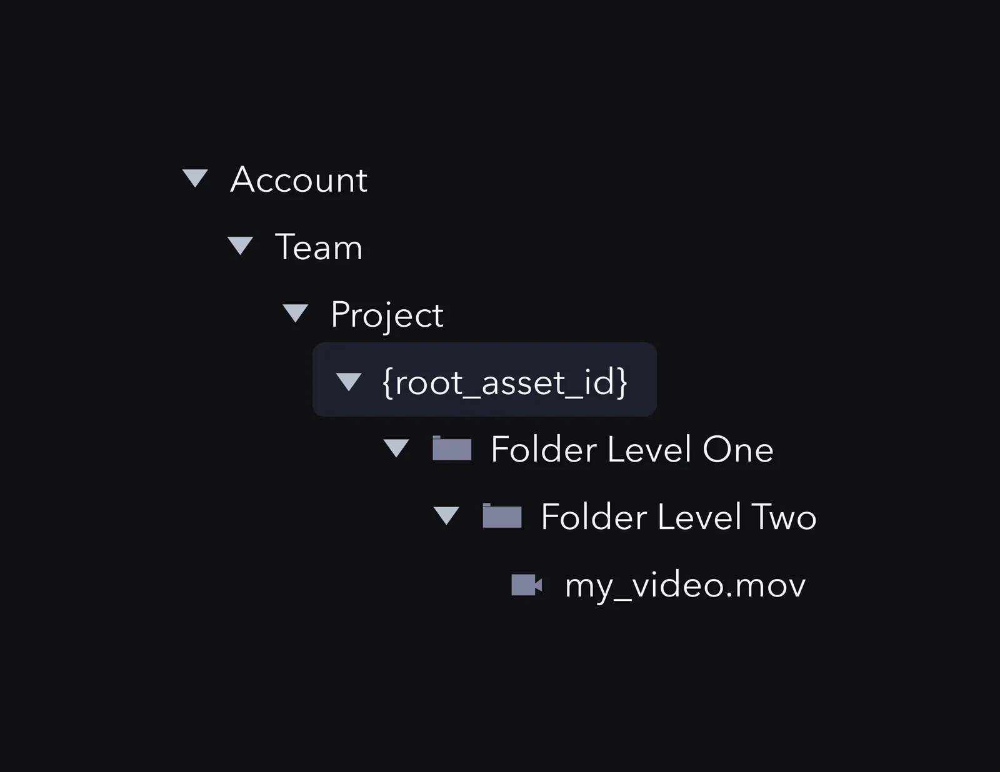

## Überblick {#overview}

Ob das Endziel nun das Veröffentlichen, Bearbeiten oder das Weiterleiten von Assets durch eine Workflow-Phase ist – viele tiefergehende Integrationen mit Frame.io erfordern das Auflisten des Benutzerkontexts und letztlich eine Verzeichnisansicht.

Hier ist die grundlegende Hierarchie der Ressourcen (oder Dateien) in Frame.io:

#### Account > Team > Project > Assets {#account->-team->-project->-assets}

Dieser Artikel erklärt, wie Sie durch aufeinanderfolgende API-Aufrufe mit dem Dateibaum interagieren.  Eine gängige Strategie für die Arbeit mit Dateien besteht darin, zunächst auf ein Project zuzugreifen, die Ordner aufzulisten und dann mit den darin enthaltenen Assets und Version Stacks zu arbeiten.

## Wichtige Konzepte {#important-concepts}

### Jedes Project hat ein eindeutiges Root-Asset {#every-project-has-a-unique-root-asset}

RESTful APIs beschreiben Ressourcen typischerweise mit eindeutigen Kennungen; die `root_asset_id` ist die eindeutige Kennung für den Asset-Baum Ihres Projects. Betrachten Sie sie als spezielles Konstrukt, das als Root-Knoten eines Projects fungiert: Die übrigen Assets befinden sich in einer nach unten verzweigenden Baumstruktur unterhalb des Roots.

In gängigen Workflows müssen API-Benutzer im Baum nach unten navigieren, um mit Assets tiefer in der Dateihierarchie zu interagieren.

### Collaborators und geteilte Projects {#collaborators-and-shared-projects}

Ein **Collaborator** ist eine zentrale Benutzerrolle in Frame.io: Solche Benutzer haben Zugriff auf einen Project-Arbeitsbereich, gehören aber möglicherweise nicht zum übergeordneten Account dieses Projects.

Abgesehen von den unterschiedlichen Berechtigungen für [Collaborators und Team Members](https://support.frame.io/en/articles/6067-difference-between-team-members-vs-collaborators) besteht der Hauptunterschied darin, dass *sich die Mitgliedschaft eines Collaborators ausschließlich auf ein Project bezieht und möglicherweise keine Verbindung zu einem Team hat*.

Das führt zu einer kleinen Tücke bei Workflows, in denen Verzeichnislisten von zentraler Bedeutung sind.  Die oben beschriebene grundlegende Hierarchie (Account > Team > Project > Assets) sollte zwar für die meisten Anwendungsfälle funktionieren, erfasst aber nicht die Projects, in denen ein authentifizierter Benutzer Collaborator, aber kein Team Member ist.  Um dies beim Auflisten von Verzeichnissen zu umgehen, können Sie entweder:

- Die geteilten Projects eines Users abrufen, die Team- und Account-Hierarchie auflösen und alles zusammenführen, oder
- Die geteilten Projects eines Users abrufen und sie gemeinsam als separaten Kontext auflisten.

Beide Methoden sind in Ordnung; die zweite ist etwas einfacher, die erste kommt jedoch der Art näher, wie die Web-App von Frame.io ähnliche Informationen darstellt. In jedem Fall gelten die in diesem Leitfaden behandelten Methoden für beide.

## Ein Verzeichnis auflisten {#listing-a-directory}

### 1. Die Accounts des Users abrufen {#1-fetch-the-user’s-accounts}

`GET https://api.frame.io/v2/accounts`

Führen Sie den obigen Aufruf mit einem gültigen Bearer Token aus, um die Accounts eines Users abzurufen.  Sie erhalten jeden Account, in dem der Benutzer den Status Team Member, Team Manager oder Admin hat.  Möglicherweise erhalten Sie auch Teams, für die ein Benutzer Abrechnungs-/Admin-Rechte, aber keinen Team-Zugriff hat. Das ist jedoch selten und wird im nächsten Schritt herausgefiltert.

Der Payload des Accounts-Requests ist recht umfangreich. Hier ist eine Zusammenfassung der wichtigen Daten, die Sie aus der Response übernehmen sollten:

- `id`
- `display_name`
- `owner` (`email`, `name`)
- (optional) `image`

<Info>

**Account-Bilder sind temporäre URLs**

*Hinweis:* Das von unserer API zurückgegebene Account-Bild ist ein vorsignierter S3-Schlüssel, daher „stirbt“ die zurückgegebene URL nach etwa einem Tag. Um dies zu umgehen, sollten Sie das Bild entweder bei jedem Laden Ihres Dienstes erneut abrufen oder es idealerweise lokal speichern.

</Info>

Beachten Sie, dass `id` und `owner.email` die einzigen Pflichtfelder eines Benutzer-Accounts sind.  Wenn Sie Benutzer in einer anderen App anzeigen, sollten Sie eine bedingte Logik für die Darstellung von Benutzer-Accounts schreiben. Wir empfehlen, die Felder zu prüfen und den Account, sofern nicht *null*, in folgender Reihenfolge anzuzeigen:

1. „`display_name`“
2. „Account von `owner.name`“
3. „Account von `owner.email`“

Sobald Ihr Benutzer einen Account ausgewählt hat, möchten Sie wahrscheinlich die Teams anzeigen, was einen zusätzlichen API-Request erfordert.

### 2. Teams innerhalb des Accounts abrufen {#2-fetch-teams-within-the-account}

`GET https://api.frame.io/v2/accounts/{{account_id}}/teams`

Teams in Frame.io können „öffentlich“ (d. h. für jeden Team Member im Account auffindbar) oder „privat“ (nur für bestimmte Team Members auffindbar) sein.  Die API übernimmt den Kontext für Sie, Sie müssen also lediglich einen gültigen Aufruf mit der `account_id` im obigen Request ausführen.

<Info>

**Vergessen Sie die Paginierung nicht**

Es ist zwar unwahrscheinlich, dass ein Benutzer in mehr als einigen wenigen Accounts existiert, doch Teams sind eine Ressource, deren Anzahl schnell anwachsen kann. Die API-Rate-Limits von Frame.io sind relativ hoch, aber es ist immer sinnvoll, die Response-Header zu prüfen und gegebenenfalls zu paginieren.

</Info>

Weitere Informationen zur Paginierung finden Sie unter [Paginierung und Fehler](https://developer.frame.io/docs/troubleshooting/troubleshooting).

**Übernehmen Sie aus jedem Team die folgenden Attribute:**

- `id`
- `name`
- (optional) `team_image`

Wenn ein Team ausgewählt wird, möchten Sie die darin enthaltenen Projects anzeigen.

**Hinweis**: Wenn Sie möchten, können Sie für einen Benutzer auch `GET https://api.frame.io/v2/teams` aufrufen. Unsere API gibt dann jedes Team zurück, dem der Benutzer angehört, unabhängig vom Account-Kontext. Das funktioniert technisch zwar, Sie riskieren jedoch, den Kontext zu verlieren, sofern Sie nicht einen weiteren Schritt unternehmen, um:

1. Den Kontext wiederherzustellen, indem Sie neben jedem Team den Account-Namen anzeigen
2. Ihrem Benutzer zu ermöglichen, den Text der Liste zu durchsuchen

Wenn Sie geteilte Projects ausgehend von der Account-Ebene abwärts auflisten, sollten Sie einen zusätzlichen Aufruf an `GET https://api.frame.io/v2/projects/shared` ausführen. Jedes in der Response zurückgegebene Project enthält die folgenden Attribute, die Sie beim Aufbau Ihres Verzeichnisses weiterverwenden können:

- `id` (des Projects selbst)
- `team_id`
- `team.account_id`

Alternativ können Sie „Shared Projects“ einfach als „Team“ in jedem ausgewählten Account-Kontext hinzufügen. Wenn Sie sich dafür entscheiden, ist es für den Endbenutzer hilfreich, wenn Sie geteilte Projects visuell von echten Team-bezogenen Projects trennen, da die einzelne Liste der geteilten Projects intern viele verschiedene echte Account- und Team-Kontexte umfassen kann.

### 3. Die Projects des Teams abrufen {#3-fetch-the-team’s-projects}

`GET https://api.frame.io/v2/teams/{{team_id}}/projects`

Führen Sie als Nächstes den obigen Aufruf aus und rufen Sie alle Projects innerhalb des Teams ab.

**Übernehmen Sie aus jedem Project:**

- `id`
- `name`
- `root_asset_id`
- (optional) `private`, falls Sie dies für den Benutzer in Ihrer Oberfläche unterscheiden möchten

Wie zu Beginn des Artikels erläutert, ist `root_asset_id` ein wichtiger Bestandteil der Ressourcenarchitektur von Frame.io, da Sie damit durch das Datei- und Ordnerverzeichnis innerhalb eines Projects navigieren können.

<Info>

**Ordner und Assets auflisten**

Fassen wir kurz zusammen, was wir bisher getan haben: Wir haben den kombinierten Kontext aus Folgendem hergestellt:

</Info>

| \* Account
| \* Team
| \* Team Projects (und root_asset_ids)
| \* Shared Projects (und root_asset_ids)
| Und das ist alles, was wir brauchen, um Assets zu erstellen oder abzurufen.

## Ordner und Assets auflisten {#listing-folders-and-assets}

### 4. Die anfängliche Ordnerstruktur aufbauen {#4-build-the-initial-folder-structure}

`GET https://api.frame.io/v2/assets/{{root_asset_id}}/children?type=folder`

Damit werden alle Ordner in einem Project aufgelistet, beginnend bei der `root_asset_id`.  Wenn keine Ordner vorhanden sind, erhalten Sie eine leere Liste zurück. Wenn Sie sowohl Dateien als auch Ordner einbeziehen möchten (z. B. wenn Ihr nächster Schritt darin besteht, ein Asset per `GET` aus Frame.io abzurufen), lassen Sie den Query-String-Parameter einfach weg.

Die beiden anderen für den type-Parameter verfügbaren Filteroptionen sind file und version_stack. Alle drei Filter schließen sich gegenseitig aus, und ein ungefilterter Aufruf gibt alle drei Typen gemischt zurück.

### 5. Den Verzeichnisbaum durchsuchen {#5-dig-through-the-directory-tree}

**Für jeden zurückgegebenen Ordner müssen Sie Folgendes erfassen:**

- `id`
- `name`

Da jeder Ordner ein Asset ist, sieht Ihr Workflow zum Durchsuchen einer Ordnerstruktur wie folgt aus:

1. `GET https://api.frame.io/v2/assets/{{root_asset_id}}/children?type=folder`

   1. Geben Sie die Ordnernamen in einer Liste aus
   2. Wenn ein Benutzer auf einen Ordner klickt, übergeben Sie die ID des Ordners an die folgende Abfrage:

2. `GET https://api.frame.io/v2/assets/{{folder_id}}/children?type=folder`

### 6. Erstellen und hochladen {#6-create-and-upload}

**In einen Ordner:**
`POST https://api.frame.io/v2/{{folder_id}}/children`

Sobald Sie die ID des Ordners haben, in den Sie hochladen möchten, senden Sie gemäß der Ressourcendokumentation und dem Leitfaden einfach einen `POST` an dessen Children. Dadurch wird ein Platzhalter-Asset erstellt und (je nach gewählter Methode) Folgendes zurückgegeben:

- Eine `uuid` für Tracking-Anwendungsfälle
- Eine Liste von upload_urls, mit denen Sie Ihre Datei per PUT direkt in den Backend-Datenspeicher von Frame.io übertragen können.

**In einen Version Stack:**
Version Stacks folgen einem ähnlichen Workflow mit einem zusätzlichen Schritt, der in [diesem Leitfaden](/de/platform/v2/manage-version-stacks) behandelt und unten zusammengefasst wird. Entscheidend ist, sich zu merken, dass ein Version Stack ein Container ist, der wie ein Asset aussieht, sich aber wie ein Ordner verhält, und dass Sie Ihr Asset zuerst hochladen und es dann in separaten Aktionen in Ihren Version Stack stapeln müssen.

Dementsprechend **benötigen Sie, wenn Sie ein Asset in einen Version Stack hochladen möchten:**

- Die `id` des Version Stacks
- Die `parent_id` des Version Stacks (z. B. den Ordner oder das Project-Root, der bzw. das ihn enthält)

Senden Sie zunächst einen `POST https://api.frame.io/v2/assets/{{parent_id}}/children`, um Ihr neues Asset zu erstellen. Erfassen Sie die neue `id` aus Ihrer Response.

Nun können Sie die ID Ihres neuen Assets verwenden und einen `POST https://api.frame.io/v2/assets/{{version_stack_id}}/version` mit folgendem Body-Payload senden:

```json
{
  "next_asset_id": "<new-asset-id>"
}
```
