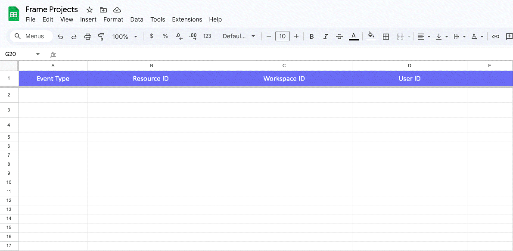

Make est une plateforme d'automatisation no-code qui connecte vos applications et services. Elle utilise une interface visuelle dans laquelle vous créez des workflows, appelés scénarios, en enchaînant différents modules.

Chaque scénario comporte un déclencheur (comme « nouveau Project créé dans Frame.io ») et des actions qui suivent (comme « ajouter une ligne dans Google Sheets »). Vous connectez ces modules visuellement pour définir ce qui se passe et dans quel ordre.

## Pourquoi connecter Frame.io à Make ? {#why-connect-frame-io-to-make}

Make étend Frame.io à l'ensemble de votre workflow. Synchronisez des fichiers vers un stockage, mettez à jour vos outils de gestion de projet, générez des rapports, informez votre équipe ou créez des workflows personnalisés basés sur l'activité de Frame.io. Plus vous connectez Frame.io à votre stack technique, plus il devient puissant.

**Idées d'automatisation :**

- Créer automatiquement des Projects Frame.io lorsqu'un client soumet un formulaire d'admission
- Publier un message dans Slack lorsque des commentaires sont ajoutés à une vidéo dans Frame.io
- Mettre à jour une Google Sheet lorsqu'un nouveau Project Frame.io est créé

Ce ne sont là que quelques exemples. Pour la liste complète des modules Frame.io disponibles, consultez cette page sur [Make.com](https://www.make.com/en/integrations/frame-io#:~:text=All-,Modules,-(26)).

## Ce dont vous avez besoin {#what-you-need}

- **Un compte Frame.io** (voir les informations d'abonnement [ici](https://frame.io/pricing))
- **Un compte Make** (offre gratuite disponible)

 

<Note>

**Organisation de ce guide** 

La section suivante présente les bases de Make. Si vous souhaitez passer directement à la pratique, rendez-vous au tutoriel, dans lequel nous connecterons votre compte Frame.io et créerons un scénario qui consigne les nouveaux Projects Frame.io dans une Google Sheet.

</Note>

## Types de modules {#module-types}

Make propose quatre types de modules : les déclencheurs, les recherches, les actions et les modules universels.

<CardGroup cols={2}>

<Card title="Déclencheurs" icon="bell" iconType="solid" horizontal={true}>

Les déclencheurs surveillent les changements dans un service et les transmettent à Make afin que vous puissiez utiliser ces données dans votre scénario. Vous pouvez ajouter **un seul** module déclencheur par scénario.

 

Consultez la section **Types de déclencheurs** ci-dessous pour en savoir plus sur les déclencheurs par polling et instantanés.

 

- Vous pouvez définir la fréquence d'exécution d'un module déclencheur en cliquant sur **Schedule settings** dans la barre d'outils du scénario
- Make recommande vivement de commencer les scénarios par un module déclencheur.

</Card>

<Card title="Recherches" icon="magnifying-glass" iconType="solid" horizontal={true}>

Les modules de recherche récupèrent des données spécifiques d'un service. Vous pouvez ajouter plusieurs modules de recherche n'importe où dans votre scénario. La plupart des recherches renvoient jusqu'à 3 200 objets par exécution.

 

**Types de modules de recherche :**

 

- Les **modules Search** vous permettent de filtrer et d'utiliser des requêtes pour trouver des données spécifiques
  (Search Records, Search Rows, etc.)
- Les **modules List** récupèrent toutes les données sans filtrage. (List Projects, List Sheets, etc.)

</Card>

<Card title="Actions" icon="bolt" iconType="solid" horizontal={true}>

Les modules d'action traitent les données récupérées d'un service. Vous pouvez ajouter autant d'actions que nécessaire, n'importe où dans votre scénario.

 

**Types d'actions :**

 

- GET
- CREATE
- UPDATE
- DELETE

 

</Card>

<Card title="Modules universels" icon="code" iconType="solid" horizontal={true}>

Les modules universels (généralement appelés **Make an API Call**) vous permettent d'effectuer des appels d'API personnalisés lorsque Make ne propose pas de module prêt à l'emploi pour ce dont vous avez besoin.

 

Vous pouvez ajouter autant de modules universels que nécessaire et les placer n'importe où dans votre scénario.

</Card>

</CardGroup>

## Types de déclencheurs {#trigger-types}

Make utilise deux types de déclencheurs : par polling et instantanés.

Les **déclencheurs par polling** vérifient périodiquement la présence de nouvelles données dans votre compte de service. Ils portent généralement des noms comme « Watch Records » ou « Watch Rows ». Lorsque le scénario s'exécute, Make demande au service s'il y a du nouveau. Si c'est le cas, le scénario le traite.

Les **déclencheurs instantanés** fonctionnent différemment. Ils utilisent des webhooks : le service notifie Make immédiatement lorsqu'un événement se produit. Votre scénario s'exécute alors aussitôt. Vous pouvez les repérer grâce à l'icône en forme d'éclair et à l'étiquette « Instant » sur le module.

Le module Watch Events de Frame.io est un déclencheur instantané : le scénario que nous allons créer plus loin s'exécutera donc en temps réel.

Make fournit plus de détails sur le fonctionnement des différents types de modules dans [cette section de son centre d'aide](https://help.make.com/types-of-modules).

# L'interface de Make {#the-make-interface}

Votre tableau de bord Make affiche tous vos scénarios. C'est ici que vous surveillez les scénarios actifs, leurs performances et votre consommation de crédits. Cliquez sur **Create scenario** dans l'en-tête pour ouvrir l'éditeur.

### Ajouter des applications et des modules {#adding-applications-+-modules}

Pour ajouter des modules à votre scénario, cliquez sur le bouton plus au centre de l'éditeur. Cela ouvre un panneau dans lequel vous pouvez rechercher l'application dont vous avez besoin, comme Frame.io ou Google Sheets, puis sélectionner le module souhaité (comme « Watch Events » ou « Add a Row »). Faites glisser et déposez les modules dans l'éditeur pour les connecter et construire votre scénario.

### Gérer et reconnecter des applications {#managing-+-reconnecting-apps}

La barre latérale gauche vous donne accès aux scénarios, aux connexions, aux webhooks et aux autres fonctionnalités de Make.

Si vous devez reconnecter Frame.io ou toute autre application, cliquez sur **Connections** dans la barre latérale gauche. Vous verrez toutes vos applications connectées, chacune accompagnée d'un bouton **Reauthorize**. Cliquez dessus pour repasser par le flux d'authentification.

### Tests {#testing}

Pour tester votre scénario, cliquez sur **Run once** dans la barre d'outils. Une fois le test terminé, des bulles d'opérations apparaissent au-dessus de chaque module, indiquant le nombre d'opérations exécutées. Cliquez sur une bulle pour voir les données d'entrée et de sortie de cette étape.

**Tester avec des données existantes :**

Par défaut, les déclencheurs ne traitent que les nouveaux événements. Pour tester avec des données existantes, cliquez sur la flèche déroulante à côté du bouton **Run once**. Cela ouvre une boîte de dialogue dans laquelle vous pouvez réexécuter les données d'un événement webhook reçu précédemment.

---

# Créer votre premier scénario : consigner les nouveaux Projects dans Google Sheets {#building-your-first-scenario-log-new-projects-to-google-sheets}

Avant de commencer, créez une Google Sheet avec les en-têtes de colonnes suivants :

**Event Type**, **Resource ID**, **Workspace ID**, **User ID**. Dans cet exemple, nous nommerons la feuille « Frame Projects ».

<Steps>

<Step title="Se connecter à Frame.io et ajouter le déclencheur">

Cliquez sur le signe plus dans l'éditeur Make pour ajouter un module. Recherchez « Frame.io » et sélectionnez **Watch Events**. Cela crée un webhook qui se déclenche lorsque des événements spécifiques se produisent dans Frame.io.

**Connecter Frame.io :**

- Cliquez sur **Add** à côté du champ de connexion
- Conservez le nom de connexion par défaut ou renommez-le
- Vous serez invité à vous connecter à votre compte Adobe et à autoriser Make
- Une fois connecté, vous verrez tous vos comptes et workspaces Frame.io disponibles dans les menus déroulants

**Configurer le webhook :**

- Sélectionnez votre compte et le workspace que vous souhaitez surveiller. Dans cet exemple, nous utiliserons « New Workspace »
- Sous les événements, choisissez **Project Created** (pour en savoir plus sur les événements pris en charge, consultez notre [documentation sur les webhooks](https://developer.adobe.com/frameio/guides/Webhooks/#webhook-event-subscriptions))
- Nommez votre webhook, puis enregistrez vos modifications

</Step>

<Step title="Ajouter Google Sheets">

Cliquez sur le signe plus pour ajouter l'étape suivante. Recherchez et sélectionnez l'application Google Sheets, puis cliquez sur le module **Add a Row**.

**Connecter Google Sheets :**

- Cliquez sur **Add** pour créer une nouvelle connexion
- Cliquez sur **Sign in with Google** et autorisez Make à accéder à votre compte Google
- Une fois connecté, vous devriez voir les feuilles de votre compte dans les menus déroulants
- Sélectionnez le nom de la feuille/de l'onglet (dans notre cas, « Frame Projects »)

**Mapper les données :**
Mappez maintenant les données Frame.io aux colonnes de votre feuille de calcul. Cliquez dans chaque champ et sélectionnez la donnée correspondante issue du déclencheur Frame.io :

- **Event Type** → mapper vers Frame.io Event Type
- **Resource ID** → mapper vers Frame.io Resource
- **Workspace ID** → mapper vers Frame.io Workspace ID
- **User ID** → mapper vers Frame.io User ID

</Step>

<Step title="Tester et activer">

Cliquez sur **Run once** pour tester le scénario, puis créez un nouveau projet dans le workspace Frame.io sélectionné. Si tout est correctement configuré, une nouvelle ligne devrait apparaître dans votre feuille de calcul.

Lorsque vous êtes prêt à passer en production, basculez l'interrupteur sur **Active** et le scénario s'exécutera automatiquement.

</Step>

</Steps>

Vous venez de créer votre première automatisation. À partir de là, vous pouvez ajouter d'autres étapes à ce scénario ou en créer de nouveaux à l'aide des autres modules Frame.io disponibles sur [Make.com](https://www.make.com/en/integrations/frame-io#:~:text=All-,Modules,-(26))

Si vous rencontrez des problèmes, avez des questions ou souhaitez partager ce que vous avez créé, rendez-vous sur le [forum de la communauté](https://forum.frame.io/).

---
