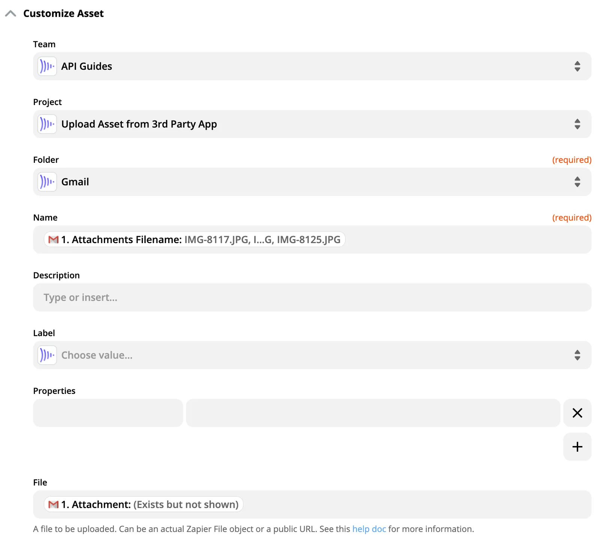

## Vue d’ensemble {#overview}

Si vous souhaitez importer des fichiers dans Frame.io depuis des applications cloud existantes ou depuis une URL qui sert des assets, Zapier est généralement une bonne solution, car leur produit résout de nombreuses divergences de conception d’API qui rendent l’interaction avec les applications cloud fastidieuse.  Ce guide précise les principales caractéristiques du service d’import de Zapier afin que vous sachiez exactement ce qui se passe dans votre intégration.

## Définir la méthode d’import de fichiers {#setting-the-file-upload-method}

Zapier essaie de découvrir automatiquement la méthode d’import de fichiers la plus flexible pour chaque API à laquelle il se connecte.  Par exemple, Zapier tente de convertir les liens restreints, inaccessibles en dehors du domaine d’une application, en liens de téléchargement publics :

Lien d’origine illisible :
`https://www.dropbox.com/s/hriinb9w3a2107m/iPad%20intro.pdf`

Lien converti, utilisable par l’API Uploader de Frame.io :
`https://dl.dropboxusercontent.com/s/hriinb9w3a2107m/iPad%20intro.pdf`

### Limites de fichiers de Zapier {#zapier’s-file-limitations}

Point important : si Zapier **ne parvient pas** à découvrir une URL de téléchargement statique à transmettre à l’API de Frame.io, le service de Zapier télécharge lui-même les fichiers à la volée et les transmet à Frame.io.  Zapier limite cette méthode aux fichiers **[de moins de 100 Mo](https://zapier.com/help/doc/common-problems-dropbox)**.

Notez que l’interface de Zapier peut vous avertir de restrictions de taille de fichier même lorsque vous transmettez une URL directe (c’est-à-dire lorsqu’il n’y a aucune restriction).  C’est pourquoi il vaut la peine de comprendre le fonctionnement de File URL.

## Méthodes d’import pour les applications et services courants {#upload-methods-for-common-apps-and-services}

**Remarque :** les intégrations de type **File Upload** sont soumises aux limites de taille de fichier indiquées dans l’interface de Zapier. Les liens directs (Direct Link) sont préférables, car ils ne sont pas soumis à des limites de taille et sont traités plus rapidement et de manière plus fiable.

| Application | Type | Conseils et références |
| --- | --- | --- |
| Gmail | File Upload | [Documentation d’aide de Zapier](https://zapier.com/help/doc/common-problems-gmail#how-can-i-attach-a-file-to-my-email-that39s-not-in-my-trigger) |
| Google Drive | Direct Link | Collez `webContentLink` dans le sélecteur de fichier.  Cela fonctionne pour les fichiers que vous importez dans Google Drive, mais pas pour les documents ou présentations créés dans Drive. [Documentation d’aide de Zapier](https://zapier.com/help/doc/common-problems-google-drive#unable-to-get-a-value-when-looking-for-quotfilequot-is-it-missing), [API Google Drive V3](https://developers.google.com/drive/api/v3/manage-downloads) |
| Dropbox | Direct Link | Importer automatiquement des fichiers Dropbox dans Frame.io |
| Box | Direct Link | Utilisez `Info Shared Link Download URL` [Guides de l’API Box](https://developer.box.com/guides/downloads/shared-link/) |
| S3 | Direct Link | Guide Zapier : problèmes courants avec S3 |
