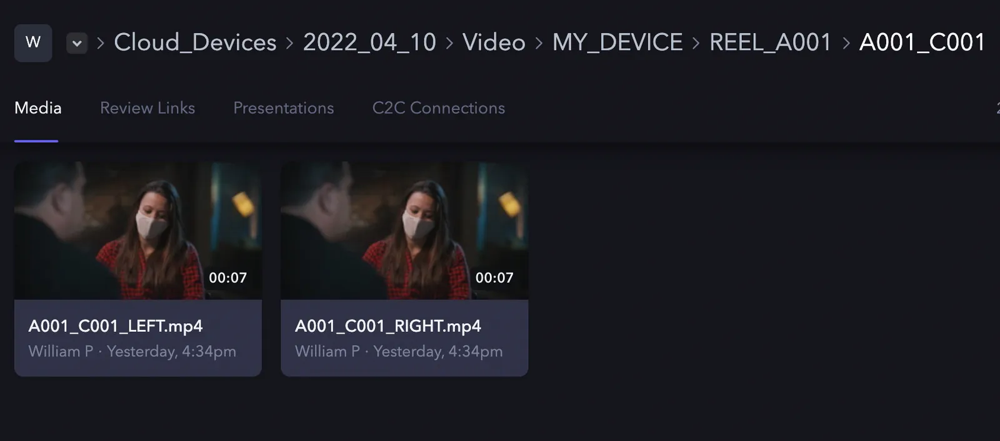

## Introduzione {#introduction}

In questa guida scopriremo come, e fino a che punto, possiamo controllare *dove* vengono caricati gli asset della tua integrazione.

## Di cosa avrò bisogno? {#what-will-i-need}

Se non hai letto la guida [Implementare C2C: configurazione](/it/camera-to-cloud/implementing-c2c-setting-up), dacci una rapida occhiata prima di proseguire!

Avrai inoltre bisogno dell'`access_token` ricevuto durante la guida all'autenticazione e all'autorizzazione per [hardware C2C](/it/platform/v2/implementing-c2c-authentication-and-authorization-hardware) o per [applicazioni C2C](/it/platform/v2/implementing-c2c-authentication-and-authorization-c2c-application).

## Struttura delle cartelle degli asset {#asset-folder-structure}

Per impostazione predefinita, gli asset vengono creati con la seguente struttura di cartelle:

`Cloud Devices` > `{YYYY}_{MM}_{DD}` > `{ASSET_TYPE}` > `{YOUR_DEVICE}` > `{ASSET_NAME}`

Dove `{ASSET_TYPE}` è `VIDEO`, `AUDIO` oppure `DATA` (configurato per canale nel tuo device model), `{YOUR_DEVICE}` è il nome del project device connesso al progetto dell'utente e `{ASSET_NAME}` è il nome dell'asset che hai caricato, ovvero l'asset effettivamente riproducibile in Frame.io.

### Instradamento in base all'estensione {#extension-routing}

Puoi configurare il tuo dispositivo per instradare asset diversi verso cartelle `{ASSET_TYPE}` personalizzate in base all'estensione del file in `{ASSET_NAME}`. Ad esempio, supponiamo che la tua integrazione produca diversi tipi di file, ciascuno con una provenienza specifica. Puoi chiederci di mappare questi asset in questo modo:

```text
.mov -> VIDEO
.mp4 -> VIDEO
.raw -> STILLS
.jpeg -> STILLS
.pdf -> CAMERA REPORTS
.las -> LiDAR Scans
```

Ora, quando crei il seguente asset:

```shell
{
curl -X POST https://api.frame.io/v2/assets \
    --header 'Authorization: Bearer [access_codes]' \
    --header 'Content-Type: application/json' \
    --header 'x-client-version: 2.0.0' \
    --data-binary @- <<'__JSON__' 
        {
            "name": "IMAGE_0001.jpeg", 
            "filetype": "image/jpeg", 
            "filesize": 21136250,
            "offset": 10
        }
__JSON__
} | python -m json.tool
```

<Info>

**Specifica dell'endpoint API**

La documentazione di `/v2/assets` è [disponibile qui](/it/camera-to-cloud/api-reference/device-asset-create)

</Info>

… verrà instradato in una posizione come: `Cloud Devices` > `2022_04_01` > `STILLS` > `MY_DEVICE` > `IMAGE_0001.jpeg`.

Se invece il file si chiamasse `A001_C001.mov`, verrebbe instradato in: `Cloud Devices` > `2022_04_01` > `VIDEO` > `MY_DEVICE` > `A001_C001.mov`.

### Percorsi di caricamento tokenizzati {#tokenized-upload-paths}

Alcune integrazioni potrebbero voler avere un maggiore controllo sulla struttura delle cartelle creata dal loro dispositivo. A nostra volta, in [Frame.io](http://frame.io/) dobbiamo assicurarci che ci sia un certo livello di coerenza nel modo in cui i file vengono caricati su [Frame.io](http://frame.io/) da un dispositivo C2C e, in particolare, fornire ai clienti di [Frame.io](http://frame.io/) garanzie su quale parte del loro progetto un dispositivo C2C può interagire. A tal fine, consentiamo agli integratori di personalizzare le posizioni di caricamento degli asset all'interno della cartella `{YOUR_DEVICE}`, ma non consentiamo di caricare asset al di fuori di tale cartella.

Per caricare in una struttura di cartelle personalizzata, dovrai collaborare con il tuo Partner Manager. Le strutture di cartelle personalizzate sono un insieme di metadati tokenizzati che devono essere forniti alla creazione dell'asset. Facciamo un semplice esempio:

Supponiamo di avere un rig per videocamere 3D con valori di `reel_name` come `"A001"`, `"A002"`, `"A003"` e così via, e valori di `clip_number` come `"C001"`, `"C002"` e così via. Vogliamo creare cartelle per ogni clip e popolarle con i file dell'occhio sinistro e dell'occhio destro, in modo che i file appaiano così in un progetto:



Per farlo, dovremo configurare due impostazioni:

- Campi di metadati obbligatori
- Percorso file tokenizzato

I campi di metadati obbligatori sono un semplice elenco di chiavi che devono essere impostate alla creazione dell'asset per la tua integrazione:

```text
[reel_name, clip_number]
```

Puoi quindi utilizzare una qualsiasi di queste chiavi per creare un percorso delimitato da `/`, usando `{field_name}` per indicare dove deve essere inserito il valore di un campo:

```text
REEL_{reel_name}/{reel_name}_{clip_number}
```

Entrambe queste impostazioni dovranno essere comunicate al nostro team di [Frame.io](http://frame.io/), che le aggiungerà ai dettagli della tua integrazione. Una volta completata la configurazione, quando crei un asset, questi valori dovranno essere forniti alla radice del payload affinché la creazione dell'asset vada a buon fine:

```shell
{
curl -X POST https://api.frame.io/v2/assets \
    --header 'Authorization: Bearer [access_token]' \
    --header 'Content-Type: application/json' \
    --header 'x-client-version: 2.0.0' \
    --data-binary @- <<'__JSON__' 
        {
            "name": "A001_C001_LEFT.mp4", 
            "filetype": "video/mp4", 
            "filesize": 21136250,
            "offset": 10,
            "metadata": {
              "reel_name": "A001",
              "clip_number": "C001"
            },
        }
__JSON__
} | python -m json.tool
```

La chiamata precedente creerà un file con un percorso completo come: `Cloud Devices` > `2022_04_01` > `VIDEO` > `MY_DEVICE` > `REEL_A001` > `A001_C001` > `A001_C001_LEFT.mp4`

<Danger>

**Errori dei metadati**

Se il tuo dispositivo non è stato configurato esplicitamente per consentire questi campi, riceverai un errore se provi a effettuare la stessa chiamata. Allo stesso modo, se configuri dei campi di metadati obbligatori, DEVI fornirli nel payload di creazione dell'asset, altrimenti verrà restituito un errore.

</Danger>

Il payload accetta qualsiasi valore JSON valido. I valori non stringa vengono resi nel modo seguente:

- **integers**: resi in base 10: `10` -> `"10"`
- **floats**: utilizza la rappresentazione più breve secondo l'algoritmo descritto in “Printing Floating-Point Numbers Quickly and Accurately” negli atti della SIGPLAN ‘96 Conference on Programming Language Design and Implementation.
- **booleans**: `true` e `false` vengono resi come `"true"` e `"false"`
- **null**: reso come stringa vuota. Se `reel_name` fosse impostato su `null`, la prima cartella personalizzata verrebbe resa come `REEL_`

In generale, ti consigliamo di limitare i valori a stringhe e di formattare gli altri valori come ritieni opportuno (ad esempio, gli interi verranno sempre stampati senza zeri iniziali, cosa che potresti voler modificare).

In generale, è opportuno utilizzare solo campi che abbiano un valore valido per ogni clip; se un campo non ha sempre un valore valido, dovresti prevedere un modo per rappresentare i valori non impostati o null.

## Version stacking {#version-stacking}

[Frame.io](http://frame.io/) supporta i [version stack](https://support.frame.io/en/articles/4431-version-stacking-and-comparison), un modo per raggruppare nell'interfaccia più iterazioni dello stesso contenuto. L'API C2C consente ai dispositivi di caricare nuove iterazioni di un asset che verranno inserite in un version stack insieme alle versioni precedenti.

Per creare un version stack, devi fornire un `autoversion_id` che identifichi il version stack a cui appartengono gli asset. Questo valore può essere qualsiasi cosa: un UUID, un nome file e così via. Fai attenzione a utilizzare solo valori che non verranno mai ripetuti involontariamente in una cartella di asset. Ad esempio, se è possibile che la tua integrazione crei lo stesso nome file più di una volta, il nome file *non* è un buon candidato da utilizzare come `autoversion_id`.

Forniamo un autoversion_id in questo modo:

```shell
{
curl -X POST https://api.frame.io/v2/assets \
    --header 'Authorization: Bearer [access_token]' \
    --header 'Content-Type: application/json' \
    --header 'x-client-version: 2.0.0' \
    --data-binary @- <<'__JSON__' 
        {
            "name": "A001_C001_v01.mov", 
            "filetype": "video/webm", 
            "filesize": 21136250,
            "offset": 10,
            "autoversion_id": "033e22ae-8544-4c9b-a84c-fcc140b0dd16"
        }
__JSON__
} | python -m json.tool
```

Ora, ogni volta che carichi un nuovo asset, se utilizzi lo stesso autoversion_id, l'asset verrà aggiunto come versione più recente in uno stack insieme all'asset originale:

```shell
{
curl -X POST https://api.frame.io/v2/assets \
    --header 'Authorization: Bearer [access_token]' \
    --header 'Content-Type: application/json' \
    --header 'x-client-version: 2.0.0' \
    --data-binary @- <<'__JSON__' 
        {
            "name": "A001_C001_v02_with_color.mov", 
            "filetype": "video/webm", 
            "filesize": 21136250,
            "offset": 10,
            "autoversion_id": "033e22ae-8544-4c9b-a84c-fcc140b0dd16"
        }
__JSON__
} | python -m json.tool
```

*Gli asset vengono raggruppati in uno stack solo se vengono caricati nella stessa cartella*, quindi dovrai tenere a mente un paio di aspetti se vuoi implementare il version stacking:

- I metadati tokenizzati devono risolversi nella stessa cartella padre affinché il version stack venga creato.
- Poiché la data di creazione fa parte del percorso del file, le nuove versioni create dopo la mezzanotte UTC potrebbero non essere raggruppate correttamente, a meno che tu non fornisca un offset relativo all'orario di creazione del caricamento originale.

Questo secondo punto è importante. Supponiamo che 48 ore dopo il caricamento iniziale venga creata una nuova versione dell'asset. Per raggrupparla con l'asset originale, dobbiamo fornire un offset di 48 ore nel passato: 172800 secondi.

```shell
{
curl -X POST https://api.frame.io/v2/assets \
    --header 'Authorization: Bearer [access_token]' \
    --header 'Content-Type: application/json' \
    --header 'x-client-version: 2.0.0' \
    --data-binary @- <<'__JSON__' 
        {
            "name": "A001_C001_v03_with_color.mov", 
            "filetype": "video/webm", 
            "filesize": 21136250,
            "offset": 172800,
            "autoversion_id": "033e22ae-8544-4c9b-a84c-fcc140b0dd16"
        }
__JSON__
} | python -m json.tool
```

Se l'asset corrente *sarebbe stato* caricato in `2022_04_03`, ora verrà caricato in `2022_04_01` e verrà raggruppato con l'asset corretto.

## Prossimi passi {#next-up}

Questa è l'ultima guida per creare un'ottima integrazione C2C! Prenditi un momento per darti una pacca sulla spalla! Magari concediti uno spuntino. Non resta che consultare la checklist dell'integratore, dove troverai un riepilogo di tutto ciò che serve per creare un'integrazione a prova di errore.

Se non l'hai già fatto, ti invitiamo a contattare il nostro team e poi a proseguire con la guida successiva. Non vediamo l'ora di sentirti!
