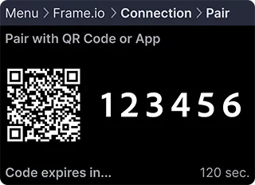

## はじめに {#introduction}

このガイドでは、Frame.io プロジェクトにおける Camera to Cloud (C2C) デバイスの認証および認可のプロセスを説明します。標準的な手動コード入力方式と、最適なユーザー体験を実現する強化された QR コードペアリング方式の両方を取り上げます。

## 必要なもの {#what-will-i-need}

まだお済みでない場合は、[実装を始める前に](/ja/camera-to-cloud/implementing-c2c-setting-up)ガイドをご確認ください。

統合を識別するための `client_secret` を私たちのチームから受け取っているはずです。受け取っていない場合は、C2C エコシステムの[こちらの紹介](/ja/camera-to-cloud/getting-started-with-cloud-device-integrations)を参照のうえ、私たちのチームにお問い合わせください。

### URL および QR コードペアリングの前提条件 {#prerequisites-for-url-&-qr-code-pairing}

URL および QR コードペアリングを実装するには、次の要件を満たしていることを確認してください。

- **デバイスの互換性**: ペアリングプロセス中に、デバイスが URL/QR コードの生成をサポートしていることを確認します。

## 認証フローの流れ {#walking-through-the-auth-flow}

ユーザーの視点から認可フローを理解するには、次のリソースを参照してください。

- 新しいデバイスの追加に関する[サポート記事](https://help.frame.io/en/collections/8960335-frame-io-c2c)。
- Teradek Cube の認可に関する[トレーニング動画](https://help.frame.io/en/articles/5091124-camera-to-cloud-training-series)。

この認可プロセスでは、実装の要件が最小限に抑えられています。次のことを行う必要はありません。

- Web ブラウザーへのリダイレクト(URL コードペアリングを使用する場合を除く)
- Frame.io のユーザー認証の処理
- アカウントやプロジェクトを選択するインターフェースの表示
- 基本的な情報表示以外の複雑な UI コンポーネントの開発

### URL コードペアリングによるユーザー体験の向上 {#enhancing-the-user-experience-with-url-code-pairing}

現代のユーザーは、効率的なデバイス操作を期待しています。現在の手動ペアリングプロセスも十分に機能しますが、最適化の余地があります。

Netflix や Disney+ などのストリーミングサービスと同様の URL および QR コードペアリングを実装することで、プロセスを大幅に効率化し、入力ミスを最小限に抑え、ペアリングにかかる時間を短縮できます。

## デバイスの識別 (client_id) {#device-identification-client_id}

ユーザーのプロジェクト内で接続を追跡するために、各物理デバイスには一意の識別子が必要です。

デバイスの場合、この識別子は `client_id` であり、認可の際に不可欠です。実装時には、デバイスのシリアル番号、UUID、その他の一意の文字列など、適切な識別子のソースを検討してください。Apple デバイスで統合を行う場合は、デバイスを再起動しても変わらない、一意で永続的な UUID を使用することをお勧めします。

個人を特定できる情報には注意してください。ユーザーのメールアドレスは `client_id` の値として適切ではありません。

また、識別子を自分で管理できるようにしてください。デバイスの MAC アドレスは、ソフトウェアが所有するものではなく、個人を特定できる情報に該当する可能性もあるため、適していません。

適切な識別子の選択についてアドバイスが必要な場合は、統合を簡素化できる適切な値の決定を私たちのチームがお手伝いします。

## ステップ 1: デバイスコードのリクエスト {#step-1-requesting-a-device-code}

実装を始めるには、`/v2/auth/device/code` エンドポイントを通じてデバイスコードをリクエストします。

### 従来のペアリング方式 {#traditional-pairing-method}

```
curl -X POST https://api.frame.io/v2/auth/device/code \
    --form 'client_id=[client_id]' \
    --form 'client_secret=[client_secret]' \
    --form 'scope=asset_create offline' \
    | python -m json.tool
```

### URL コードペアリングの有効化 {#enabling-url-code-pairing}

URL コードペアリングを使用するには、追加のヘッダーを付けて API 呼び出しを変更します。

```
curl -X POST https://api.frame.io/v2/auth/device/code \
    --header "x-client-version: 2.0.0" \
    --header "x-client-platypus-enabled: true" \  # New header to enable URL pairing
    --form 'client_id=[client_id]' \
    --form 'client_secret=[client_secret]' \
    --form 'scope=asset_create offline' \
    | python -m json.tool
```

**注:** これらの認証エンドポイントは、JSON ではなくフォームデータのみを受け付けます。認証後は他のエンドポイントで JSON ペイロードを使用できますが、認証エンドポイントは JSON リクエストを拒否します。

#### ペイロードのパラメーター {#payload-parameters}

- **client_id**: 物理デバイスの一意の識別子。シリアル番号や UUID など、一意であることが保証されている必要があります。

- **client_secret**: デバイスモデルを識別するために Frame.io サポートから提供される値。この機密値はユーザーから保護し、保存する際は暗号化する必要があります。

- **scope**: リクエストする権限をスペース区切りで指定します。デバイスがリクエストできるのは次のとおりです。

  - `asset_create`: アセットの作成とアップロードを可能にします。
  - `offline`: リフレッシュトークンによる認可の更新を許可します。このスコープがない場合、認可トークンの有効期限が切れるため、ユーザーは 8 時間ごとにデバイスを再認可する必要があります。

実際の実装では、デバイスは通常両方のスコープをリクエストします。

### API レスポンスについて {#understanding-the-api-response}

リクエストすると、次のようなレスポンスが返されます。

#### 従来のペアリングのレスポンス {#traditional-pairing-response}

```
{
  "device_code": "[device_code]",
  "expires_in": 120,
  "interval": 5,
  "name": "MyDevice-[client_id]",
  "user_code": "573131"
}
```

#### URL ペアリングのレスポンス {#url-pairing-response}

```
{
  "device_code": "[device_code]",
  "expires_in": 120,
  "interval": 5,
  "name": "MyDevice-[client_id]",
  "user_code": "573131",
  "verification_uri": "https://next.frame.io/pair",
  "verification_uri_complete": "https://next.frame.io/pair/573131"
}
```

#### レスポンスの内訳 {#response-breakdown}

- **device_code**: ユーザーには表示しない内部識別子で、ポーリング中に認可リクエストを識別します。
- **expires_in**: コードの有効期間(秒)。
- **interval**: 推奨されるポーリング間隔(秒)。
- **name**: 接続するデバイスの識別子。
- **user_code**: デバイスのペアリングのために Frame.io に手動で入力する 6 桁のコード。
- **verification_uri**: QR コードのスキャンが利用できない場合に手動で入力するためのベース URL。
- **verification_uri_complete**: ペアリングコードを含む完全な URL。モバイルアプリ内でハイパーリンクとして使用したり、QR コードを生成したりして、ユーザーがペアリング画面にスムーズに移動できるようにすることを目的としています。

### ユーザーへの QR コードの表示 {#displaying-the-qr-code-to-the-user}

`verification_uri_complete` を使用して QR コードを生成し、デバイスの画面に表示してユーザーにスキャンしてもらうことで、効率的なペアリングを実現します。

#### 例: QR コードを表示したデバイス画面 {#example-device-screen-with-qr-code-displayed}



必ず代替手段を用意してください。QR コードのスキャンができない場合に備えて、手動入力用の `user_code` と `verification_uri` を表示します。あるいは、モバイルでスキャンできるように `verification_uri` を静的な QR コードとして表示することも検討してください。

モバイルアプリの統合では、アプリを実行しているデバイスからは QR コードをスキャンできないため、`verification_uri_complete` をタップ可能なハイパーリンクとして含めてください。

## ステップ 2: ユーザーの認可のポーリング {#step-2-polling-for-user-authorization}

ペアリングコードまたは URL コードを提供した後、次のリクエストでユーザーが入力したかどうかを確認します。

```
curl -X POST https://api.frame.io/v2/auth/token \
    --form 'client_id=[client_id]' \
    --form 'device_code=[device_code]' \
    --form 'grant_type=urn:ietf:params:oauth:grant-type:device_code' \
    | python -m json.tool
```

### ペイロードのパラメーター {#payload-parameters-1}

- **client_id**: ステップ 1 で使用したものと同じ識別子。
- **device_code**: 前に返された `device_code` の値。
- **grant_type**: OAuth のグラントタイプの識別子。この実装では常に `urn:ietf:params:oauth:grant-type:device_code` です。

最初のポーリングでは、通常次のレスポンスが返されます。

```
{
  "error": "authorization_pending"
}
```

この致命的でないエラーは、ユーザーがまだコードの入力を完了していないことを示します。完了するまでポーリングを続けてください。

> **iOS アプリのデバイスに関する注意:** ユーザーがペアリングコードを入力するために Frame.io iOS アプリに切り替えると、アプリがバックグラウンドに移行する場合があります。`applicationDidBecomeActive` などでアプリが再びアクティブになったときにポーリングを再開し、ユーザーがペアリングをやり直すことなく認可フローを続行できるようにしてください。

次のレスポンスを受け取った場合は、

```
{
  "error": "expired_token"
}
```

ユーザーが入力する前にコードの有効期限が切れています。ステップ 1 で新しいコード/QR コードを生成してユーザーに表示し、ポーリングを再開してください。

認可に成功すると、次のレスポンスが返されます。

```
{
  "access_token": "[access_token]",
  "expires_in": 28800,
  "refresh_token": "[refresh_token]",
  "token_type": "bearer"
}
```

Camera to Cloud デバイスの認可に成功しました。おめでとうございます!

このレスポンスを見てみましょう。

- **access_token**: Frame.io バックエンドにアクセスするための認証情報で、今後の API リクエストのヘッダーで必要になります。
- **expires_in**: アクセストークンの有効期間(秒)。この期間が過ぎると更新が必要です。
- **refresh_token**: アクセストークンの管理に使用します。主に認可の更新に使用しますが、取り消しにも使用できます。
- **token_type**: C2C API の実装では常に `bearer` であり、対応は不要です。

## ステップをまとめる {#putting-the-steps-together}

それでは、デバイスコードの有効期限切れの可能性にも対処しながら、これらの API 呼び出しを Python 風の疑似コードで実装してみましょう。

```python title="Python"
def authorize_with_frame():
    """
    Handles authorizing our device with Frame.io.
    """

    # Our client ID can be a serial number, UUID, or some other unique string.
    client_id = THIS_DEVICE.get_serial_number()

    while True:
        # Make the call to Frame.io to get our device codes.
        pairing_codes = c2c.get_device_codes(client_id)

        # We need to keep track of how long we have been polling for
        polling_started = datetime.now()

        # Now we are going to poll for authorization until the user enters the code.
        while True:

            # Re-write this output each time we poll. Note: This message will only update once
            # per `interval` (e.g., 5 seconds), so if a smooth countdown is desired, that will
            # need a different implementation.
            print(
                f"\rPAIRING CODE: {pairing_codes.user_code}, "
                f"EXPIRES IN: {pairing_codes.expires_in - (datetime.now() - polling_started).seconds} seconds"
            )

            # Wait for `interval` before polling each time.
            sleep(pairing_codes.interval)

            # Make a call to Frame.io to see if the user has entered the code and authorized
            # the device.
            authorization, error = c2c.poll_for_authorization(
                client_id, pairing_codes.device_code
            )

            if error and error.message == "authorization_pending":
                # If the authorization is pending, try again.
                continue
            elif error and error.message == "expired_token":
                # If the pairing codes have expired, break to generate new codes.
                break
            elif error:
                # If there was some other error, raise it.
                raise error
            else:
                # If there was no error, we have our authorization!
                return authorization

        # If we get here, our pairing codes expired. Let's try again.
        print("\nPairing code expired. Generating a new one...")
```

**注:** 外側のループは、ペアリングコードの有効期限が切れて新しいコードが必要になった場合に対処します。

最後のステップとして、Frame.io からプロジェクト情報を取得して表示し、目的のプロジェクトに正常にペアリングされたことを確認します。これについては次のチュートリアルで説明します。

## ペアリング用の QR コードの作成と表示 {#creating-and-displaying-qr-codes-for-pairing}

URL/QR コードペアリングを実装する場合は、レスポンスの `verification_uri_complete` の値から QR コードを生成する必要があります。さまざまなプログラミング言語で一般的なライブラリを使用した例を次に示します。

### qrcode を使用した Python の例 {#python-example-using-qrcode}

```python title="Python"
import qrcode
from PIL import Image
import io

def generate_qr_code(verification_uri_complete, size=250):
    """
    Generate a QR code from the verification_uri_complete URL.
    
    Args:
        verification_uri_complete (str): The complete verification URI returned by Frame.io
        size (int, optional): Size of the QR code in pixels. Defaults to 250.
    
    Returns:
        PIL.Image: QR code image that can be displayed or saved
    """
    qr = qrcode.QRCode(
        version=1,
        error_correction=qrcode.constants.ERROR_CORRECT_L,
        box_size=10,
        border=4,
    )
    qr.add_data(verification_uri_complete)
    qr.make(fit=True)
    
    img = qr.make_image(fill_color="black", back_color="white")
    
    # Resize the image if needed
    img = img.resize((size, size))
    return img

# Example usage in authorization flow
def display_qr_for_pairing(pairing_codes):
    """
    Generate and display QR code along with manual pairing instructions.
    """
    if hasattr(pairing_codes, 'verification_uri_complete'):
        # Generate QR code from the verification URI
        qr_img = generate_qr_code(pairing_codes.verification_uri_complete)
        
        # Display the QR code on screen
        # For GUI applications like Tkinter, PyQt, etc.
        # display_image(qr_img)
        
        # For headless devices or testing, save to file
        qr_img.save("frame_io_pairing_qr.png")
        
        print(f"Scan the QR code or visit: {pairing_codes.verification_uri}")
        print(f"Manual code: {pairing_codes.user_code}")
    else:
        # Fallback for devices that received traditional pairing response
        print(f"Enter code on Frame.io: {pairing_codes.user_code}")
```

### JavaScript の例(Web または Electron) {#javascript-example-web-or-electron}

```javascript
import QRCode from 'qrcode';

/**
 * Generate and display a QR code from the verification URI
 * @param {string} verificationUriComplete - The complete verification URI from Frame.io
 * @param {string} elementId - ID of the HTML element to display the QR code in
 */
function displayQRCode(verificationUriComplete, elementId = 'qrcode-container') {
  const element = document.getElementById(elementId);
  
  if (!element) {
    console.error(`Element with ID ${elementId} not found`);
    return;
  }
  
  // Clear any existing content
  element.innerHTML = '';
  
  // Generate QR code
  QRCode.toCanvas(element, verificationUriComplete, { width: 250 }, function(error) {
    if (error) {
      console.error('Error generating QR code:', error);
      // Fallback to displaying the URL as a link
      element.innerHTML = `<a href="${verificationUriComplete}" target="_blank">Click here to pair</a>`;
    }
  });
  
  // Also display manual pairing information
  const manualInfoDiv = document.createElement('div');
  manualInfoDiv.innerHTML = `
    <p>Scan the QR code or <a href="${verificationUriComplete}" target="_blank">click here</a> to pair your device.</p>
    <p>Manual code: ${userCode}</p>
  `;
  element.parentNode.appendChild(manualInfoDiv);
}

// Example usage in authorization flow
async function requestDeviceCode() {
  try {
    const response = await fetch('https://api.frame.io/v2/auth/device/code', {
      method: 'POST',
      headers: {
        'x-client-version': '2.0.0',
        'x-client-platypus-enabled': 'true'
      },
      body: new URLSearchParams({
        'client_id': YOUR_CLIENT_ID,
        'client_secret': YOUR_CLIENT_SECRET,
        'scope': 'asset_create offline'
      })
    });
    
    const data = await response.json();
    
    if (data.verification_uri_complete) {
      displayQRCode(data.verification_uri_complete);
      window.userCode = data.user_code; // Store for display purposes
    } else {
      // Fallback for traditional pairing
      displayManualPairingCode(data.user_code);
    }
    
    // Begin polling for authorization
    beginPollingForAuthorization(data.device_code, data.interval);
    
  } catch (error) {
    console.error('Error requesting device code:', error);
  }
}
```

### Android の例 (Java) {#android-example-java}

```java
import android.graphics.Bitmap;
import android.widget.ImageView;
import com.google.zxing.BarcodeFormat;
import com.google.zxing.MultiFormatWriter;
import com.google.zxing.common.BitMatrix;
import com.journeyapps.barcodescanner.BarcodeEncoder;

public void generateAndDisplayQRCode(String verificationUriComplete, ImageView qrCodeImageView) {
    try {
        MultiFormatWriter multiFormatWriter = new MultiFormatWriter();
        BitMatrix bitMatrix = multiFormatWriter.encode(verificationUriComplete, 
            BarcodeFormat.QR_CODE, 250, 250);
        BarcodeEncoder barcodeEncoder = new BarcodeEncoder();
        Bitmap bitmap = barcodeEncoder.createBitmap(bitMatrix);
        
        // Display in ImageView
        qrCodeImageView.setImageBitmap(bitmap);
        
    } catch (Exception e) {
        e.printStackTrace();
        // Fallback to displaying the URL as text
    }
}
```

### iOS の例 (Swift) {#ios-example-swift}

```swift
import UIKit
import CoreImage

func generateQRCode(from string: String) -> UIImage? {
    let data = string.data(using: String.Encoding.utf8)
    
    if let filter = CIFilter(name: "CIQRCodeGenerator") {
        filter.setValue(data, forKey: "inputMessage")
        filter.setValue("H", forKey: "inputCorrectionLevel")
        
        if let outputImage = filter.outputImage {
            // Scale the image
            let transform = CGAffineTransform(scaleX: 10, y: 10)
            let scaledImage = outputImage.transformed(by: transform)
            
            // Convert to UIImage
            let context = CIContext()
            if let cgImage = context.createCGImage(scaledImage, from: scaledImage.extent) {
                return UIImage(cgImage: cgImage)
            }
        }
    }
    
    return nil
}

// Usage in your view controller
func displayPairingQRCode(verificationUriComplete: String) {
    if let qrCodeImage = generateQRCode(from: verificationUriComplete) {
        qrCodeImageView.image = qrCodeImage
        
        // Also show manual pairing information
        pairingInstructionsLabel.text = "Scan the QR code or enter code manually"
        pairingCodeLabel.text = userCode
    } else {
        // Fallback to manual code display
        pairingInstructionsLabel.text = "Enter this code on Frame.io:"
        pairingCodeLabel.text = userCode
    }
}
```

## QR コード表示のベストプラクティス {#best-practices-for-qr-code-display}

QR コードペアリングを実装する際は、最適なユーザー体験のために次のガイドラインを考慮してください。

1. **最適なサイズ**: 確実にスキャンできるよう、QR コードは少なくとも 200〜250 ピクセル四方で表示します。

2. **コントラスト**: QR コードと背景のコントラストを高くします(白地に黒が理想的です)。

3. **誤り訂正**: コードの密度と信頼性のバランスを取るため、中程度の誤り訂正レベル(L または M)を使用します。

4. **明確な説明**: 「スマートフォンのカメラでこのコードをスキャンしてデバイスをペアリングしてください」など、コードのスキャン方法をわかりやすく案内します。

5. **複数の選択肢**: 代替手段として、QR コードと一緒に手動ペアリングコードを必ず表示します。

   ```
   Scan to pair:
   [QR CODE]

   Or enter code manually: 573131
   ```

6. **モバイルアプリ用のハイパーリンク**: 統合がモバイルアプリケーションの場合、ユーザーは同じデバイスから QR コードをスキャンできないため、`verification_uri_complete` をタップ可能なリンクとして含めます。

7. **テスト**: 確実にスキャンできるよう、さまざまなデバイスや照明条件で QR コードをテストします。


## トラブルシューティング {#troubleshooting}

問題が発生した場合は、次の一般的なシナリオと解決策を参照してください。

- **「Connect Device」ボタンが表示されない**: C2C 管理パネルにアクセスした際にこの状況が発生する場合、次のことが考えられます。

  - **権限不足**: 権限に関するメッセージが表示される場合は、アカウントマネージャーに連絡して権限を調整するか、適切なロールを割り当ててもらってください。
  - **既存のデバイス接続**: 1 台のデバイスを接続すると、メインの「Add New Device」ボタンは、C2C Connections パネルの右上隅にある三点メニューに置き換わります。

- **Invalid Client エラー**: `invalid_client` レスポンスは、デバイス情報の不一致を示します。通常は `client_secret` が正しくないことが原因です。

- **Bad Request エラー**: `bad_request` レスポンスは、リクエストデータの形式が正しくないことを示します。フィールド名を確認し、必須フィールドがすべて含まれていることを確認してください。

ここで取り上げていない問題が発生した場合は、このトラブルシューティングのセクションを改善できるよう、ぜひその内容をお知らせください。

## 次のステップ {#next-steps}

私たちのチームにご連絡のうえ、[認可管理のガイド](/ja/camera-to-cloud/how-to-authorization-management)へお進みください。皆様からのフィードバックをお待ちしています!
