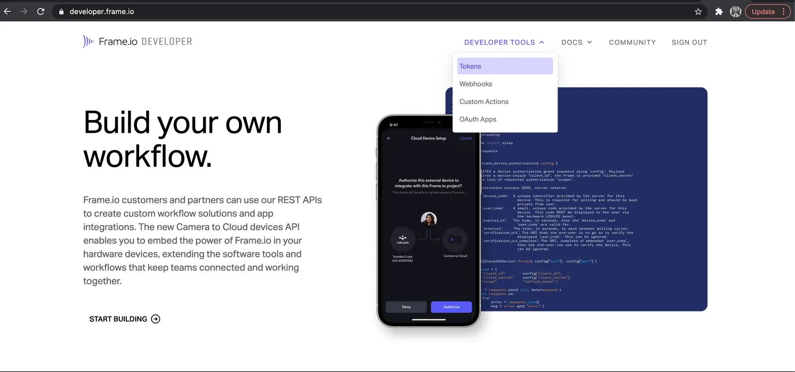
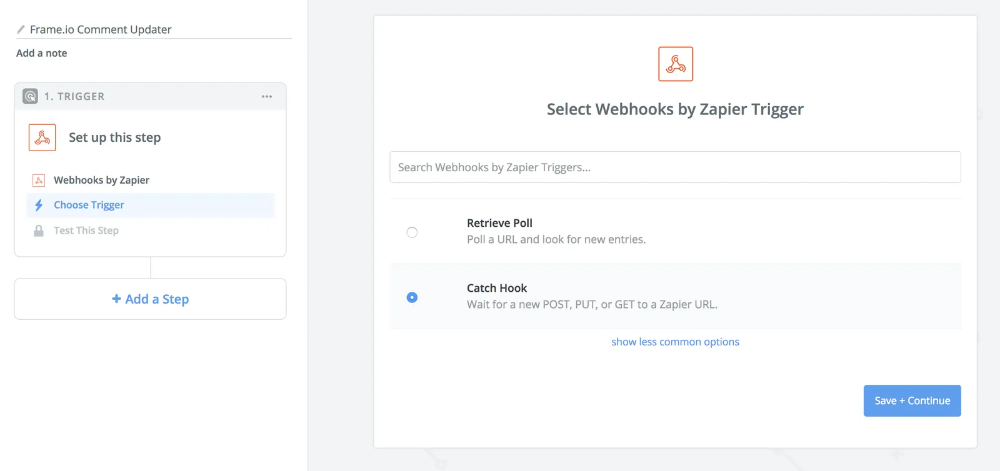
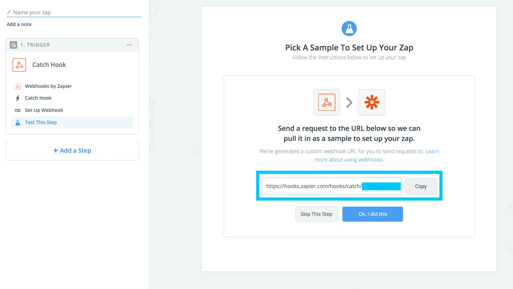
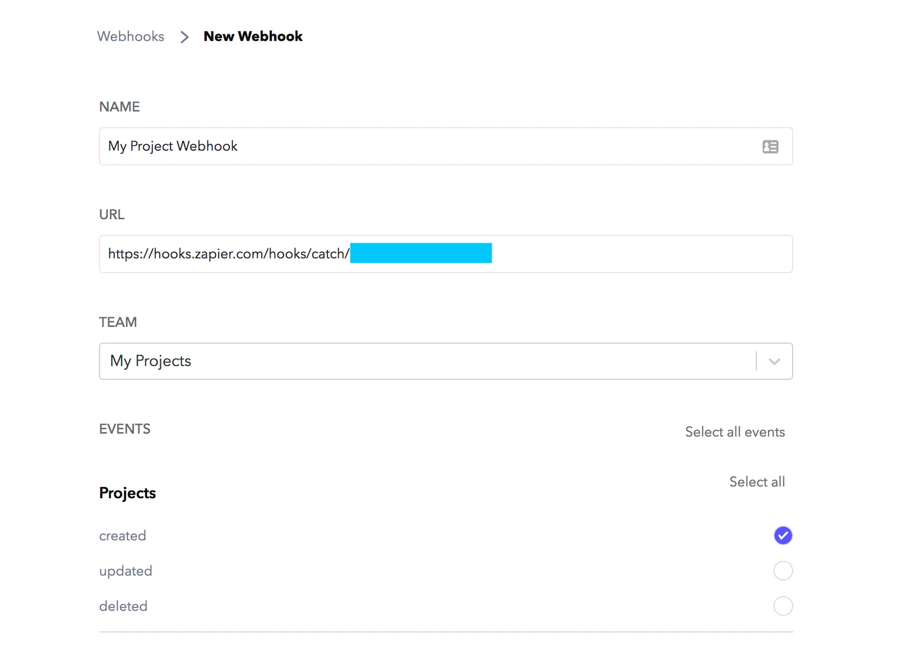
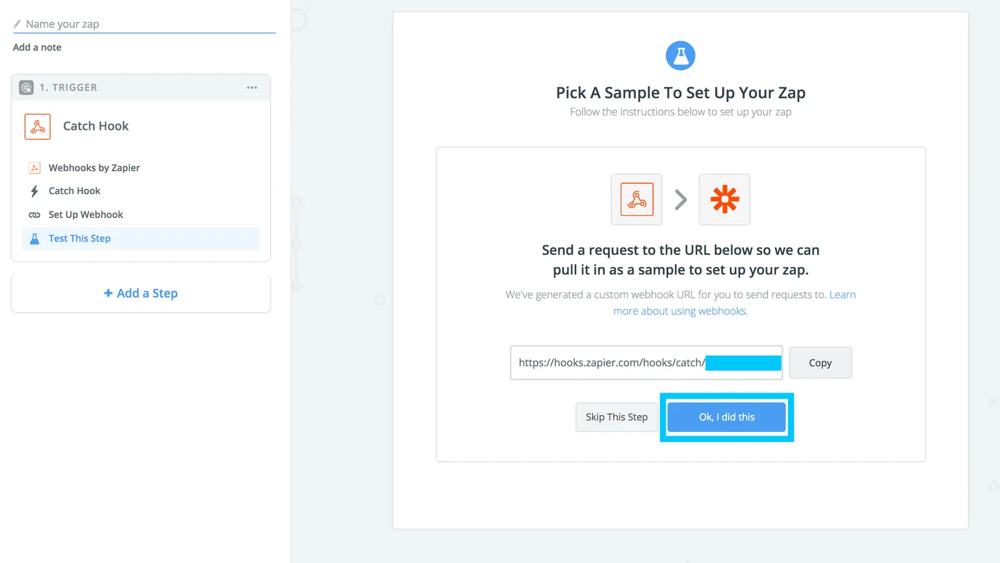
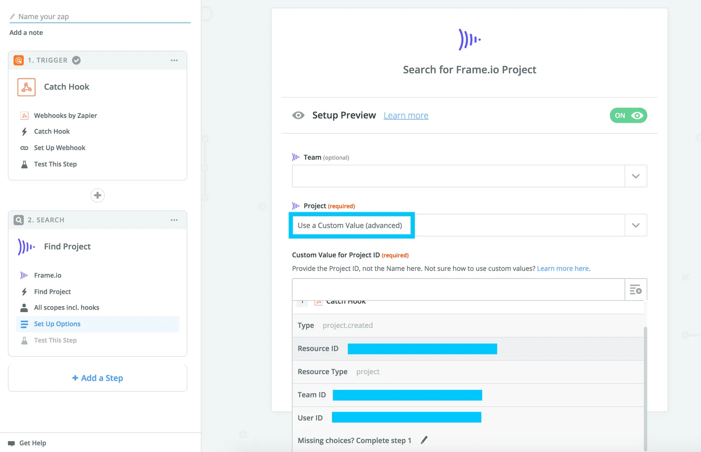
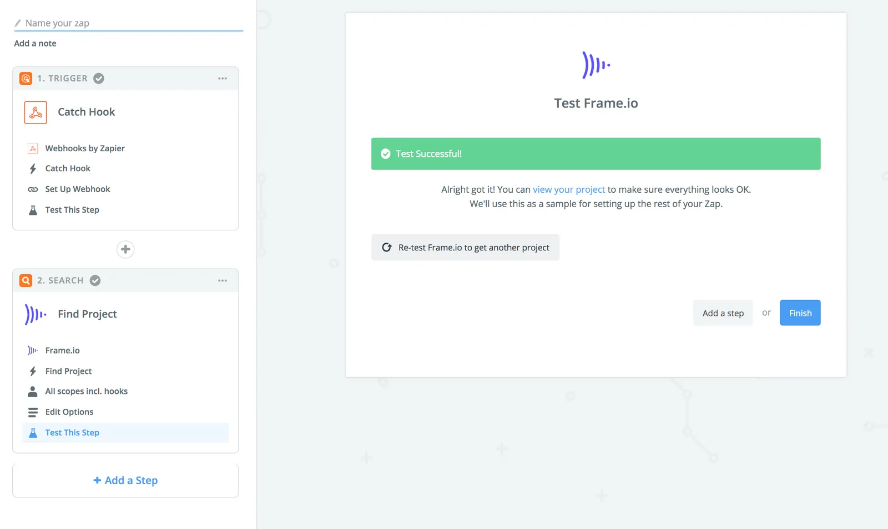

## 概要 {#overview}

このガイドでは、Frame.io の Team に対して Webhook イベントを作成し、それを使って [Zapier](https://zapier.com) にペイロードを送信します。このシナリオでは、Zapier が仲介役として機能します。Frame.io からのフックを「キャッチ」し、そのフックのデータを使って他のシステムとやり取りできます。

多くの場合、Frame.io の Zapier インテグレーションは、手動で Webhook を管理しなくても Frame.io からデータを取得できるネイティブの「トリガー」をサポートしています(例: Asset が作成されたとき)。このガイドでは、現在ネイティブのトリガーではサポートされていないワークフローとして、Frame.io で新しい Project が作成されたときに反応する方法に焦点を当てます。

まず、Frame.io の Team で新しい Project が作成されたときに通知を送信する Webhook を設定します。次に、Frame.io の Zapier アプリを使ってその通知をキャッチし、Project に関する情報を Google スプレッドシートに送ります。

<Info>

**手順に沿って進めましょう**

このガイドでは、Frame.io と Zapier の間をある程度行き来することになります。最良の結果を得るために、2 つのアプリを並べて開いた状態で進めることをお勧めします。

</Info>

### 必要なもの {#things-you’ll-need}

始める前に、次の 3 つが必要です。

1. Frame.io アカウントへのアクセス権(トークンを作成するため)
2. Frame.io の Team に対する Team Manager または Admin のアクセス権(Webhook を作成するため)
3. Zapier アカウント

最初の 2 つを確認するには、[developer.frame.io](/ja/platform/v2) にアクセスしてサインインします。「Tokens」と「Webhooks」のメニュー項目(下図)が表示されない場合は、Frame.io のアカウント担当者にお問い合わせください。

## ステップ 1: API トークンを作成する {#step-1-create-an-api-token}

このガイドを完了するには、送信する Webhook のスコープと一致する[スコープ](/ja/platform/v2/authentication)を持つ API トークンが必要です。以下のスコープを含むトークンがすでに Zapier に接続されている場合は、それをそのまま使用できます。そうでない場合は、次のようにします。

新しいトークンにわかりやすい名前を付け、次のスコープを選択します。

- **Projects:** Read

## ステップ 2: Zapier で Webhook を作成する {#step-2-create-a-webhook-in-zapier}

**Zapier で:** トリガーアプリとして「**Webhooks by Zapier**」を選び、トリガーアクションとして「**Catch Hook**」を選択します。

保存したら、次の任意のステップをスキップします。すると、`https://hooks.zapier.com/...` で始まる URL が表示された画面になるはずです。

**この画面で:**

1. この URL をコピーします
2. Zapier は開いたままにします
3. 別のタブまたはウィンドウで Frame.io Developer に戻ります

## ステップ 3: Frame.io で Webhook イベントを設定する {#step-3-set-up-the-webhook-event-in-frame-io}

**Frame.io Developer に戻ったら:** [Webhooks](https://developer.frame.io/webhooks) に移動し、次の内容で新しい Webhook を作成します。

1. わかりやすい名前
2. 前のステップでコピーした URL
3. このフックを動作させたい Team
4. フックに関連付けたい Frame.io のイベント(このガイドでは Projects -> Created)

**Create** ボタンで新しい Webhook を保存し、Zapier に戻ります。

## ステップ 4: テストフックを送信する {#step-4-send-a-test-hook}

**ここまでの内容をまとめると、次のものが用意できました:**

1. 特定の Team で Project を作成したときに送信される、Frame.io の Webhook 設定
2. Frame.io からの新しい Project を待ち受ける、Zapier の Webhook トリガー

それでは、Project を作成して、実際に Zapier にデータを送信しましょう。

### a) Zapier で: Webhook をキャッチする準備をする {#a-in-zapier-prepare-to-catch-the-webhook}

ステップ 2 から開いたままの画面で、「**Ok, I did this.**」をクリックします。これにより、Zapier が指定の URL でイベントをキャッチする準備が整います。

### b) Frame.io で: 新しい Project を作成する {#b-in-frame-io-create-a-new-project}

設定した Team で、新しい Project を作成します。設定は自由に決めてかまいません。

これにより Webhook が送信され、Zapier がそれをキャッチします。その結果、Zapier に新しいフックを受信したことが表示され、それを展開すると Frame.io からの Webhook のペイロード全体を確認できるはずです。

**おめでとうございます**!**Continue** をクリックして、自分を軽くねぎらいましょう。これで難しい部分は終わりました。あとは Webhook を使っていろいろな*処理*を行えます!

## ステップ 5: Project を取得する {#step-5-get-your-project}

### a) Frame.io のアクションを追加する {#a-add-the-frame-io-action}

「**+ Add a Step**」をクリックし、Frame.io を検索します。Frame.io アプリを選択したら、**Find Project** アクションを選びます。次に「**Save + Continue**」をクリックします。

### b) Frame.io アカウントを接続する {#b-connect-your-frame-io-account}

次の画面で「**Connect an Account**」をクリックし、続いて表示されるポップアップに、(ステップ 1 で生成した)Frame.io の API トークンを入力します。それまでの間にトークンを忘れたり紛失したりしても心配はいりません。[Account Settings](https://app.frame.io/account?k=tokens) で新しいトークンを作成し、「**Project**: Read」スコープを必ず選択してください。「**Continue**」をクリックします。

### c) Project を取得する {#c-fetch-your-project}

次の画面で、リストの一番下にある **Project** フィールドの右端の矢印をクリックし、**Use a Custom Value** を選択します。

次に、表示された新しい「Custom Value for Comment ID」フィールドで右側のアイコンをクリックし、続いて表示されるドロップダウンから `Resource ID` を選択します。

<Info>

**これはよく使われるパターンです**

すべてのイベントで常に最新のデータを扱えるようにするため、Frame.io と Zapier の間で Webhook を設定する際は、常にこの **Custom Value** + **Resource ID** のパターンに従ってください。これはネイティブでサポートされているトリガーにも当てはまります!

</Info>

次に「**Continue**」をクリックします。次の画面で Zapier が Project ID を取得できたことを確認したら、「**Fetch + Continue**」をクリックします。取得が完了すると、次のような画面が表示されるはずです。

お見事です!これで、新しい Project に関するすべての情報が Zapier に揃いました。この情報は、次のようなさまざまなシステムに送ることができます。

- Google Sheets
- Airtable
- Asana
- Trello
- Jira
  …その他 3,000 近くのアプリ。

Zap の残りの部分を構築したら、Zap を「On」にするだけで完了です!
