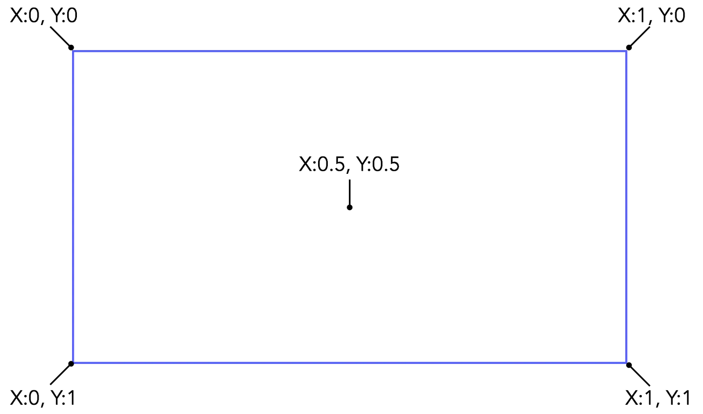
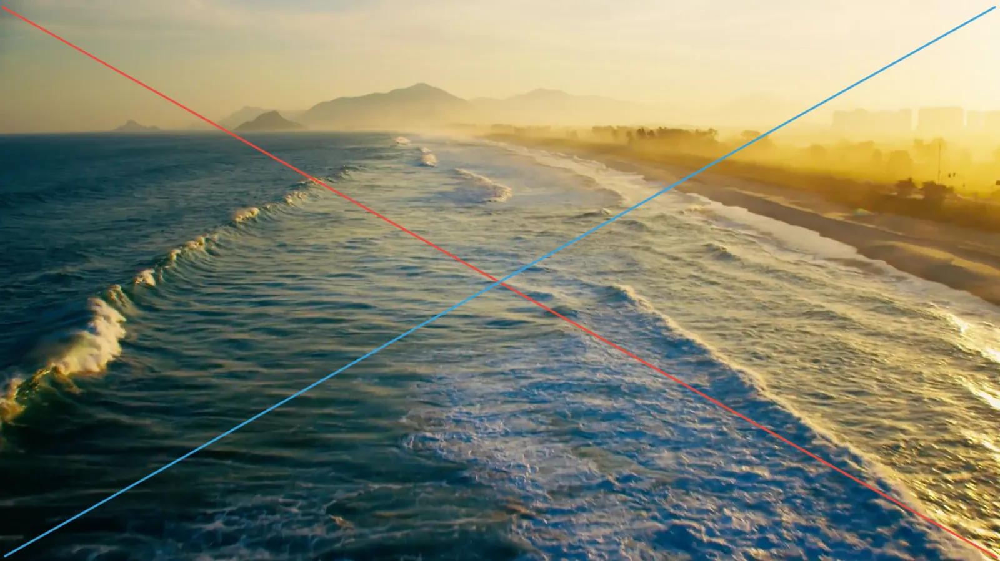
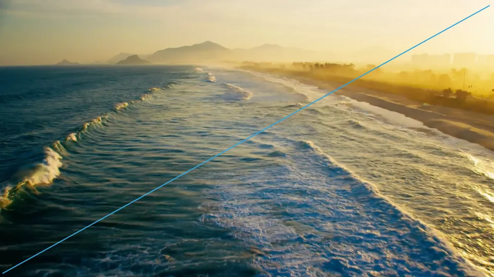
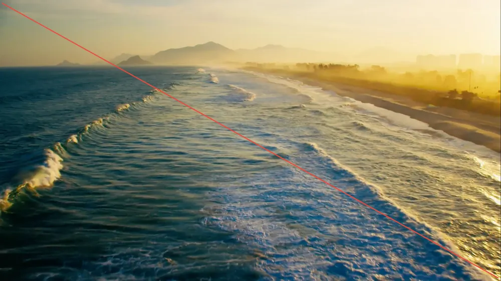
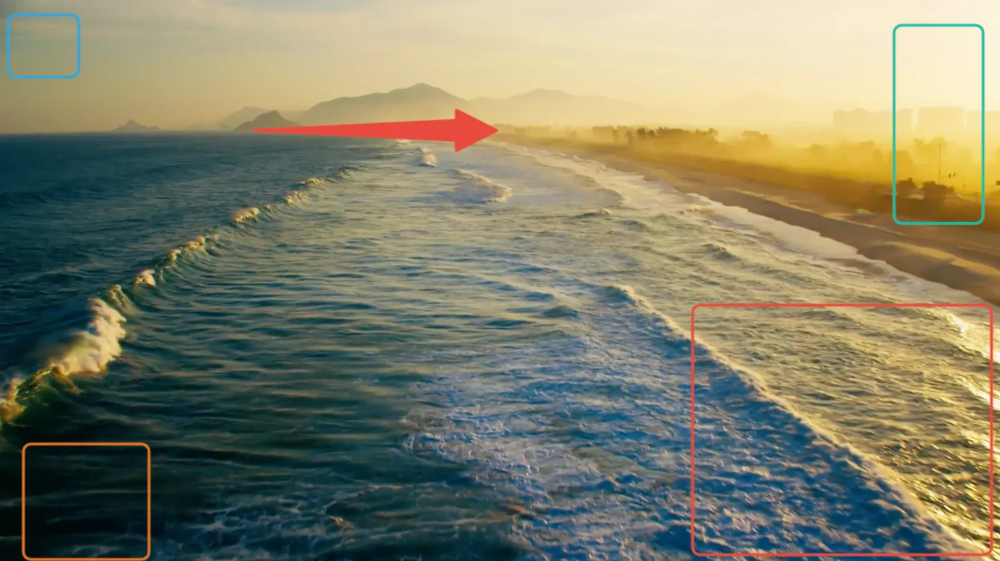
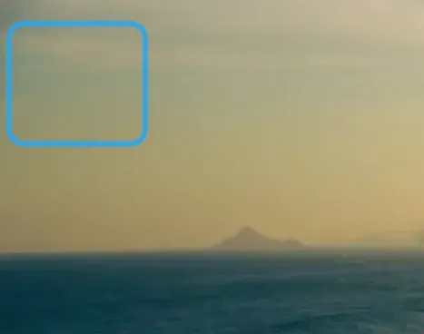
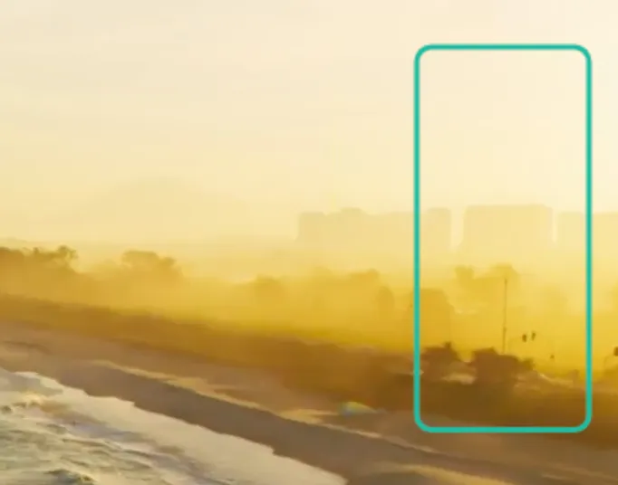
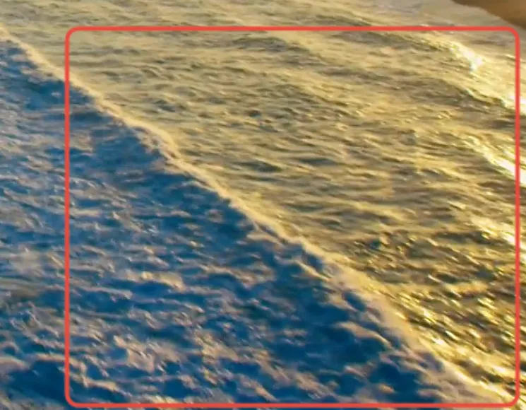
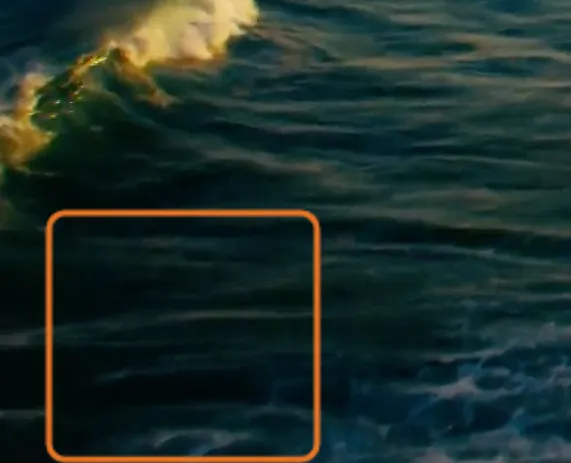
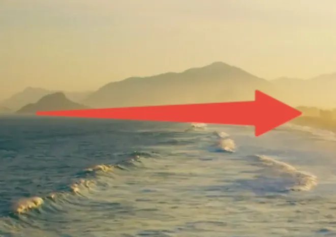

# 概要 {#overview}

Frame.io のアノテーションは、色、座標、サイズを含む描画オブジェクトのシリアライズされた JSON blob として表現されます。この blob では、外側を囲む一対を除くすべての引用符がスラッシュでエスケープされます(例: `\"key\":\"value\"`)。

基本的なシェイプは **arrow**、**rect**、**line** の 3 種類です。これに加えてフリーハンド描画もありますが、本ガイドの対象外です。ただし、フリーハンド描画もシリアライズされた座標データという同じ基本原則に従います。

## 座標系 {#the-coordinate-system}

すべてのシェイプは、左上を原点とし、各軸が 0 から 1 のスケールを持つデカルト座標系上に配置されます。



## 基本的なシェイプデータ {#basic-shape-data}

すべてのシェイプは、座標とスタイルデータの組み合わせによって上記の平面上に配置されます。各シェイプにはいくつかの共通属性があり、そのうえで座標系の扱い方がシェイプごとに少しずつ異なります。

距離・幅・高さに関する属性はすべて、メインの座標グリッドと同じ 0 から 1 のスケールを使用しますが、通常はシェイプの原点を基準に指定されます。

つまり、動画が 640x480 のビューポートで表示されている場合、その状況では `x=1` は絶対値で 640px に相当します。これにより、表示画面やサイズ、コンテキストが変わっても、アノテーションは相対的な位置を保ったままシームレスに拡大縮小されます。

**注**: *rect* の原点は、描画の開始位置に関係なく、常にシェイプの左上隅です。

### 共通属性 {#common-attributes}

| 属性 | 説明 |
| --- | --- |
| `tool` | *arrow*、*rect*、または *line*。作成するシェイプを示します。 |
| `color` | シェイプの 6 桁の 16 進カラーコード。 |
| `size` | シェイプの線のピクセルサイズ。矢印の場合、終端の幅はプログラムによって決定されるため、この値は線の始点にのみ適用されます。 |

### Arrow {#arrow}

| 属性 | 説明 |
| :--- | :--- |
| `x` | 矢印の原点の x 座標。 |
| `y` | 矢印の原点の y 座標。 |
| `w` | 矢印の始点から終点までの y 軸方向の位置の差(矢印の原点基準)。 |
| `h` | 矢印の始点から終点までの x 軸方向の位置の差(矢印の原点基準)。 |

### Rect {#rect}

| 属性 | 説明 |
| :--- | :--- |
| `x` | 矩形の左上隅の x 座標。 |
| `y` | 矩形の左上隅の y 座標。 |
| `w` | 矩形の幅(矩形の左上の原点基準)。 |
| `h` | 矩形の高さ(矩形の左上の原点基準)。 |
| `ix` | 矩形の描画開始位置の x 座標(任意)。 |
| `iy` | 矩形の描画開始位置の y 座標(任意)。 |
| `radius` | 矩形の角の丸みの半径。正の値である必要があります。150 を超える値は見た目上区別できません。 |

### Line {#line}

| 属性 | 説明 |
| :--- | :--- |
| `x1` | 線の始点の x 座標。 |
| `y1` | 線の始点の y 座標。 |
| `x2` | 線の終点の x 座標。画像平面上の絶対値です。 |
| `y2` | 線の終点の y 座標。画像平面上の絶対値です。 |

## シンプルな例: 座標平面 {#simple-example-the-coordinate-plane}



```text
{"annotation": "[{\"tool\":\"line\",\"color\":\"#E74A3C\",\"size\":3,\"x1\":0.0028530670470756064,\"y1\":0.012680297987002695,\"x2\":0.9964336661911555,\"y2\":0.9903312727849104},{\"tool\":\"line\",\"color\":\"#34A3DB\",\"size\":3,\"x1\":0.004992867332382311,\"y1\":0.98779521318751,\"x2\":0.9942938659058488,\"y2\":0.012680297987002695}]}
```

```json
{
    "annotation": [
        {
            "tool": "line",
            "color": "#E74A3C",
            "size": 3,
            "x1": 0.0028530670470756064,
            "y1": 0.012680297987002695,
            "x2": 0.9964336661911555,
            "y2": 0.9903312727849104
        },
        {
            "tool": "line",
            "color": "#34A3DB",
            "size": 3,
            "x1": 0.004992867332382311,
            "y1": 0.98779521318751,
            "x2": 0.9942938659058488,
            "y2": 0.012680297987002695
        }
    ]
}
```

### 内訳 {#breakdown}



```json
{
   "tool":"line",
   "color":"#34A3DB",
   "size":3,
   "x1":0.004992867332382311,
   "y1":0.98779521318751,
   "x2":0.9942938659058488,
   "y2":0.012680297987002695
}
```



```json
{
   "tool":"line",
   "color":"#E74A3C",
   "size":3,
   "x1":0.0028530670470756064,
   "y1":0.012680297987002695,
   "x2":0.9964336661911555,
   "y2":0.9903312727849104
}
```

## 複雑な例: 多数のボックス {#complex-example-lots-of-boxes}



```text
{"annotation": "[{\"tool\":\"rect\",\"color\":\"#34A3DB\",\"size\":3,\"x\":0.008426966292134831,\"y\":0.02663337494798169,\"w\":0.0702247191011236,\"h\":0.10986267166042447,\"ix\":0.008426966292134831,\"iy\":0.02663337494798169,\"radius\":8},{\"tool\":\"rect\",\"color\":\"#1ABCA1\",\"size\":3,\"x\":0.8932584269662921,\"y\":0.0449438202247191,\"w\":0.08895131086142327,\"h\":0.35122763212650854,\"ix\":0.8932584269662921,\"iy\":0.0449438202247191,\"radius\":8},{\"tool\":\"rect\",\"color\":\"#E67422\",\"size\":3,\"x\":0.023408239700374533,\"y\":0.7873491468997087,\"w\":0.1254681647940075,\"h\":0.2047440699126093,\"ix\":0.023408239700374533,\"iy\":0.7873491468997087,\"radius\":8},{\"tool\":\"rect\",\"color\":\"#E74A3C\",\"size\":3,\"x\":0.6919475655430711,\"y\":0.5409904286308781,\"w\":0.29868913857677903,\"h\":0.4427798585101955,\"ix\":0.6919475655430711,\"iy\":0.5409904286308781,\"radius\":8},{\"tool\":\"arrow\",\"color\":\"#E74A3C\",\"size\":3,\"x\":0.25374531835205993,\"y\":0.23137744486059092,\"w\":0.24250936329588013,\"h\":0}]}"
```

```json
{
    "annotation": [
        {
            "tool": "rect",
            "color": "#34A3DB",
            "size": 3,
            "x": 0.008426966292134831,
            "y": 0.02663337494798169,
            "w": 0.0702247191011236,
            "h": 0.10986267166042447,
            "ix": 0.008426966292134831,
            "iy": 0.02663337494798169,
            "radius": 8
        },
        {
            "tool": "rect",
            "color": "#1ABCA1",
            "size": 3,
            "x": 0.8932584269662921,
            "y": 0.0449438202247191,
            "w": 0.08895131086142327,
            "h": 0.35122763212650854,
            "ix": 0.8932584269662921,
            "iy": 0.0449438202247191,
            "radius": 8
        },
        {
            "tool": "rect",
            "color": "#E67422",
            "size": 3,
            "x": 0.023408239700374533,
            "y": 0.7873491468997087,
            "w": 0.1254681647940075,
            "h": 0.2047440699126093,
            "ix": 0.023408239700374533,
            "iy": 0.7873491468997087,
            "radius": 8
        },
        {
            "tool": "rect",
            "color": "#E74A3C",
            "size": 3,
            "x": 0.6919475655430711,
            "y": 0.5409904286308781,
            "w": 0.29868913857677903,
            "h": 0.4427798585101955,
            "ix": 0.6919475655430711,
            "iy": 0.5409904286308781,
            "radius": 8
        },
        {
            "tool": "arrow",
            "color": "#E74A3C",
            "size": 3,
            "x": 0.25374531835205993,
            "y": 0.23137744486059092,
            "w": 0.24250936329588013,
            "h": 0
        }
    ]
}
```

### 内訳 {#breakdown-1}

以上を踏まえ、上の画像の各要素を個別に見ていくと、アノテーションの座標系をより明確に理解できます。なお、この例の各矩形の `size` と `radius` には、Frame.io UI のデフォルト値が使用されています。

#### 青い rect {#blue-rect}



```json
{
   "tool":"rect",
   "color":"#34A3DB",
   "size":3,
   "x":0.008426966292134831,
   "y":0.02663337494798169,
   "w":0.0702247191011236,
   "h":0.10986267166042447,
   "ix":0.008426966292134831,
   "iy":0.02663337494798169,
   "radius":8
}
```

#### 緑の rect {#green-rect}



```json
{
   "tool":"rect",
   "color":"#1ABCA1",
   "size":3,
   "x":0.8932584269662921,
   "y":0.0449438202247191,
   "w":0.08895131086142327,
   "h":0.35122763212650854,
   "ix":0.8932584269662921,
   "iy":0.0449438202247191,
   "radius":8
}
```

#### 赤い rect {#red-rect}



```json
{
   "tool":"rect",
   "color":"#E74A3C",
   "size":3,
   "x":0.6919475655430711,
   "y":0.5409904286308781,
   "w":0.29868913857677903,
   "h":0.4427798585101955,
   "ix":0.6919475655430711,
   "iy":0.5409904286308781,
   "radius":8
}
```

#### オレンジの rect {#orange-rect}



```json
{
   "tool":"rect",
   "color":"#E67422",
   "size":3,
   "x":0.023408239700374533,
   "y":0.7873491468997087,
   "w":0.1254681647940075,
   "h":0.2047440699126093,
   "ix":0.023408239700374533,
   "iy":0.7873491468997087,
   "radius":8
}
```

#### 赤い矢印 {#red-arrow}



```json
{
   "tool":"arrow",
   "color":"#E74A3C",
   "size":3,
   "x":0.25374531835205993,
   "y":0.23137744486059092,
   "w":0.24250936329588013,
   "h":0
}
```
