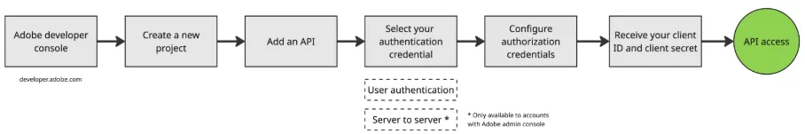

## Dostęp dla wszystkich kont {#all-account-access}

Wszystkie konta Frame V4 — nie tylko te zarządzane za pośrednictwem Adobe Admin Console — mogą tworzyć tokeny i uzyskiwać dostęp do API V4. Klienci i partnerzy mogą testować, tworzyć i udoskonalać swoje przepływy pracy, korzystając z naszych najnowszych funkcji API.

<Steps>

<Step title="Utwórz token uwierzytelniania użytkownika">

Odwiedź Adobe Developer Console, aby utworzyć token uwierzytelniania użytkownika. Aby zweryfikować dostęp do tokenu API, użytkownik musi używać tego samego Adobe ID, którego używa do logowania się we Frame.

</Step>

<Step title="Utwórz dane uwierzytelniające API">

Po uzyskaniu dostępu do API następnym krokiem jest utworzenie danych uwierzytelniających API, czyli tokenu API, służących do komunikacji z Frame. Utwórz dane uwierzytelniające API na stronie developer.adobe.com.

</Step>

</Steps>

<Info>

Wszystkie konta V4, zarówno zarządzane przez Frame (V4F), jak i przez Adobe (V4A), mogą utworzyć projekt w Adobe Developer Console, a następnie utworzyć dane uwierzytelniające. Gdy masz już zestaw danych uwierzytelniających (OAuth Client ID/Client Secret), możesz przeprowadzić integrację z trójetapowym przepływem OAuth platformy Adobe Developer Platform. Zaloguj się do swojej tożsamości Adobe Identity, aby otrzymać prawidłowy token uwierzytelniania i token odświeżania, umożliwiające wysyłanie żądań do Frame.io V4 Developer API!

</Info>

## Projekty i przestrzenie robocze {#projects-and-workspaces}

### Zmiany w przestrzeniach roboczych {#workspace-updates}

Strona startowa Frame.io jest nowa i nosi nazwę strony Workspace. Użytkownicy mogą przeglądać przestrzenie robocze i projekty, do których mają dostęp w ramach konta. Dzięki nowemu projektowi łatwiej sprawdzić, kto należy do danej przestrzeni roboczej, i szybko zaprosić nowe osoby.

<Note>

We Frame V3 przestrzenie robocze nazywały się zespołami (Teams).

</Note>

W V4 przestrzenie robocze są ustawione jako dostępne tylko na zaproszenie, więc użytkownicy widzą wyłącznie te przestrzenie robocze, do których zostali wyraźnie zaproszeni. Ponadto w ustawieniach konta nie ma strony katalogu zespołów (Team Directory).

Aby zarządzać uprawnieniami i powiązanymi operacjami, użyj endpointów Create, List, Delete i Update Workspace.

<CardGroup cols={1}>

<Card title="Operacje zarządzania przestrzenią roboczą" icon="users" iconType="solid" horizontal={true}>

- Wyświetlanie listy ról użytkowników dla danej przestrzeni roboczej.
- Usuwanie użytkownika z danej przestrzeni roboczej.
- Aktualizacja ról użytkowników dla danej przestrzeni roboczej, jeśli użytkownik został już do niej dodany. Jeśli użytkownik nie został dodany do przestrzeni roboczej, zostanie dodany z podaną rolą.

</Card>

</CardGroup>

### Zmiany w projektach {#project-updates}

Proces tworzenia projektu zmienił się w V4. Teraz, rozpoczynając nowy projekt, wybierasz między pustym projektem a szablonem projektu. Do wyboru jest dwanaście szablonów, zaprojektowanych z myślą o typowych kreatywnych przepływach pracy. Możesz też uwzględnić zasoby demonstracyjne szablonu lub zacząć wyłącznie od struktury szablonu. Wybranie szablonu projektu natychmiast tworzy nowy projekt w Twojej przestrzeni roboczej.

Aby zarządzać uprawnieniami i powiązanymi operacjami, użyj endpointów Create, List, Delete i Update Project.

<CardGroup cols={1}>

<Card title="Operacje zarządzania projektem" icon="folder" iconType="solid" horizontal={true}>

- Wyświetlanie listy ról użytkowników dla danego projektu.
- Usuwanie użytkownika z danego projektu.
- Aktualizacja ról użytkowników dla danego projektu, jeśli użytkownik został już do niego dodany. Jeśli użytkownik nie został dodany do projektu, zostanie dodany z podaną rolą.

</Card>

</CardGroup>
