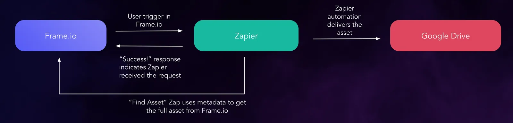
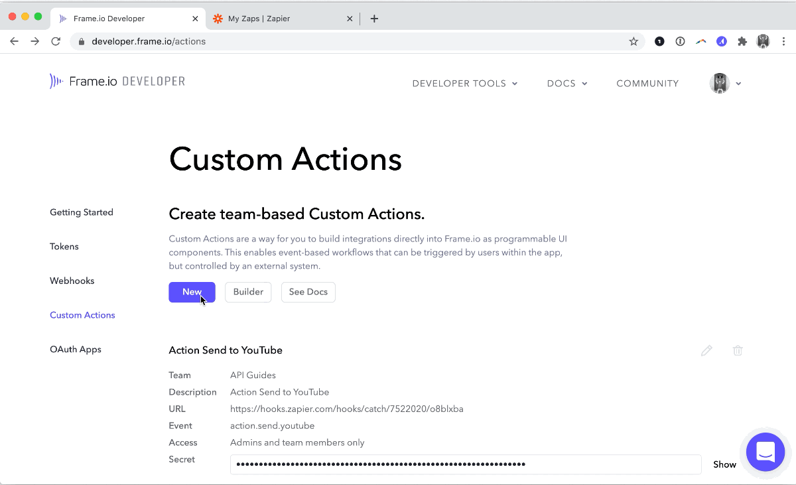
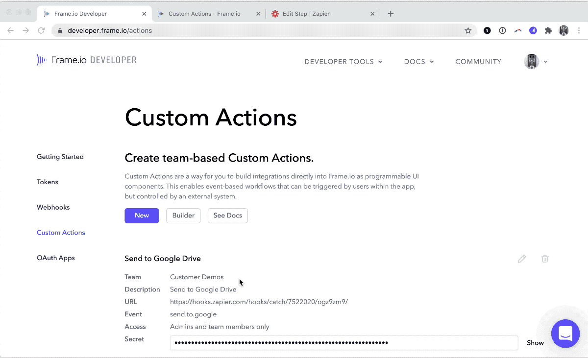
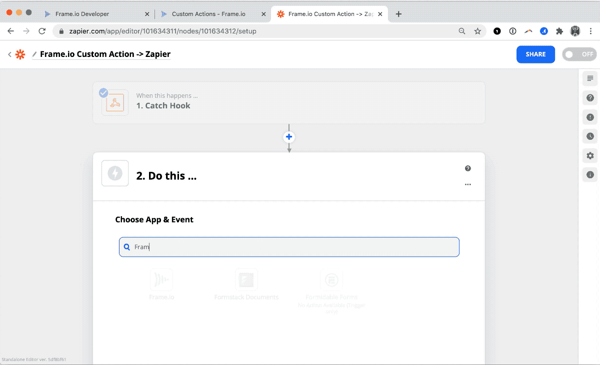
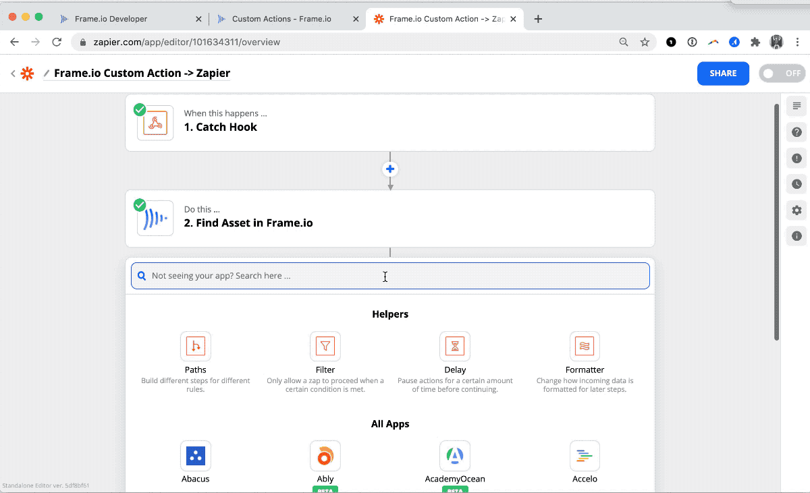
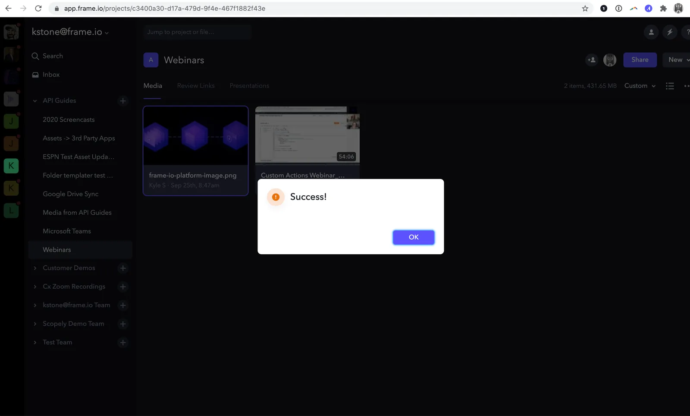

<Info>

**Pierwszy raz pracujesz z Custom Actions?**

Dowiedz się więcej o tej funkcji na **[stronie przeglądu](/pl/platform/v2/custom-actions-overview)**.

</Info>

W ramach workflowu multimedialnego może zajść potrzeba przesyłania multimediów z Frame.io do kanałów publikacji, takich jak YouTube i Wistia, lub do miejsc przechowywania, takich jak Google Drive czy archiwum Amazon S3.

Choć do automatyzacji workflowów możesz używać wyzwalaczy (Triggers) Zapier, Custom Actions pozwalają utworzyć w Frame.io opcję menu, która daje dodatkowy poziom kontroli nad usprawnianiem dostarczania multimediów do lokalizacji zewnętrznych; a ponieważ Custom Actions to po prostu webhooki uruchamiane na żądanie, możesz połączyć je z Zapier jako niestandardowe wyzwalacze. Wystarczy skonfigurować to raz, a członkowie zespołu i współpracownicy będą mieli dostęp do automatyzacji z poziomu Frame.io.

**Z tego przewodnika dowiesz się, jak połączyć Custom Actions Frame.io z Zapier i dostarczać multimedia do aplikacji lub usługi innej firmy.**

**Uwaga:** Webhooki to funkcja Premium w Zapier. Aby wdrożyć Custom Actions przy minimalnych kosztach, rozważ [napisanie własnej funkcji bezserwerowej](https://github.com/Frameio/custom-actions-example-app/tree/master/examples/custom-action-offload-to-s3).

## Architektura {#architecture}

## Skonfiguruj Zapier i utwórz Custom Action {#set-up-zapier-and-create-your-custom-action}

Utwórz nowego Zapa w Zapier. Jako początkowy wyzwalacz wybierz [Zap - Webhooks by Zapier](https://zapier.com/apps/webhook/integrations). Ustaw akcję na „Catch Hook”. W tym przypadku nie jest wymagane żadne dostosowanie, więc przejdź do następnego etapu:

### Przetestuj akcję {#test-the-action}

Poświęć chwilę na przetestowanie Custom Action w Frame.io. Sprawdź, czy akcja generuje żądanie, które zostaje przechwycone w Zapier:

<Info>

**Wskazówka**

Użyj [logów](https://developer.frame.io/actions) w naszej witrynie dla deweloperów, aby przeanalizować payload Custom Action

</Info>

### Dodaj krok „Find Asset” w Zapier {#add-a-‘find-asset’-step-to-zapier}

Payload Custom Action jedynie odwołuje się do Twojego Assetu – nie zawiera samego pliku. Potrzebny jest dodatkowy krok, który wskaże Zapier, skąd pobrać plik. Dodaj do Zapa wyzwalacz typu „search” – [Frame.io - Find Asset](https://zapier.com/apps/frameio/integrations#css-d28kn1-Button__buttonText)

Oto konfiguracja Find Asset w praktyce:

Teraz przekazujesz do Zapier więcej informacji o Assecie, w tym jego nazwę, oryginalny plik oraz każde z [transkodowań](https://support.frame.io/en/articles/13321-what-is-my-video-converted-to-when-it-s-uploaded), które Frame.io wykonało na pliku.

### Wyślij Asset do miejsca docelowego {#send-the-asset-to-your-destination}

Na potrzeby demonstracji dostarczymy plik do Google Drive:

## Co dalej {#where-to-go-from-here}

Choć Zapier jest prawdopodobnie najłatwiejszym sposobem wdrażania akcji, ma pewne ograniczenia. Przede wszystkim nie możesz komunikować się z użytkownikiem w [pełnym wzorcu żądanie–odpowiedź](https://docs.frame.io/docs/custom-actions#create-a-form-callback) obsługiwanym przez Custom Actions. Użytkownik otrzymuje jedynie domyślny komunikat „Success!” – oznaczający, że Zapier obsłużył webhook i uruchomił łańcuch akcji w Zapie:

Może to wprowadzać w błąd, ponieważ komunikat „Success!” oznacza jedynie pomyślne przekazanie i pojawi się nawet wtedy, gdy coś zawiedzie w samym workflowie Zapier. Więcej informacji o rozwiązywaniu problemów z samym Zapier znajdziesz w jego przewodniku [exploring task history](https://zapier.com/learn/getting-started-guide/task-history/).

### Tworzenie własnej aplikacji {#rolling-your-own-app}

Napisanie [małej aplikacji serwerowej](https://github.com/Frameio/custom-actions-app-python) lub użycie [funkcji Lambda](https://github.com/Frameio/custom-actions-example-app/tree/master/examples/custom-action-offload-to-s3) pozwala obsługiwać dane wprowadzane przez użytkownika i tworzyć wiele ścieżek kodu, co jest wygodnym sposobem na wysyłanie plików do wielu miejsc docelowych, odmienną obsługę różnych typów plików lub wykorzystanie informacji o użytkowniku Frame.io w automatyzacji workflowu.
