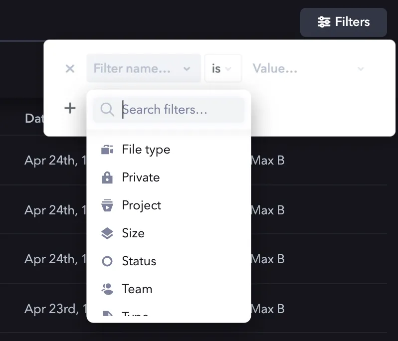
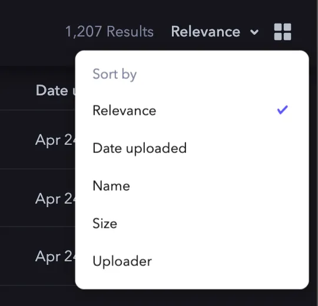

# Przegląd {#overview}

API Frame.io obsługuje zaawansowane wyszukiwanie fasetowe zasobów (Assets) w obrębie całego konta (Account), odzwierciedlając funkcjonalność aplikacji webowej. Choć najczęściej przydatnymi filtrami są Team, Project i Status, filtry i sortowanie można łączyć na różne sposoby, aby uzyskać bardzo precyzyjne zbiory wyników sterowane przez API. Ogólnie wszystkie filtry poza `account_id`, `q` (zapytanie) i `sort` mają tę samą strukturę — wszystkie zostały wyjaśnione poniżej.



<Warning>

**Niezgodność między żądanym a zwracanym rozmiarem strony**

Od marca 2022 r. występuje znany błąd wpływający na funkcję stronicowania API wyszukiwania. Dopóki ten błąd nie zostanie naprawiony, nie zalecamy używania API wyszukiwania do iterowania po wielu stronach wyników (tj. ponad 100 zasobach), ponieważ żądany rozmiar strony może nie odpowiadać rzeczywistej liczbie zwróconych zasobów.

</Warning>

## Wartości domyślne {#defaults}

Żądanie API uruchamiające wyszukiwanie jest zawsze takie samo:

Zawsze jest to to samo żądanie

`POST` do `https://api.frame.io/v2/search/library`

Jeśli nie zostaną podane jawnie, domyślne wartości parametrów wyszukiwania są następujące:

| Atrybut | Wartość domyślna | Opis |
| :--- | :--- | :--- |
| `page_size` | 10 | Na stronę zwracanych jest 10 zasobów. |
| `page` | 1 | Zapytanie zwróci pierwszą stronę odpowiedzi. |
| `sort` | `relevance` | „Relevance” (trafność) próbuje uporządkować zasoby na podstawie specjalnie dobranego zestawu atrybutów. W przypadku braku zapytania trafność jest silnie uzależniona od tego, jak niedawno przesłano zasób. |

## Informacje o tym przewodniku {#about-this-guide}

Ten przewodnik przeprowadza przez proces budowania zapytania wyszukiwania, które dopasowuje:

- Zasoby w obrębie konta
- Które pasują do zapytania `"moon"`
- Znajdują się w określonym projekcie
- Zostały przesłane między 1 a 30 kwietnia 2020 r.
- I zostały oznaczone jako „Approved”

Treść naszego żądania wyszukiwania będzie ostatecznie wyglądać tak:

```json
{
    "account_id": "<account_id>",
    "q": "moon",
    "sort": "name",
    "filter": {
        "inserted_at": [
            {
                "op": "gte",
                "value": "2020-04-01T04:00:00.000Z"
            },
            {
                "op": "lte",
                "value": "2020-04-30T03:59:59.999Z"
            }
        ],
        "project_id": {
            "op": "eq",
            "value": "<project_id>"
        },
        "label": {
            "op": "eq",
            "value": "approved"
        }
    },
    "page_size": 10,
    "page": 1
}
```

### Konto, zapytanie i sortowanie {#account-query-and-sort}

Konto (`account_id`), zapytanie (`q`) i `sort` to trzy najbardziej podstawowe elementy, które w zapytaniu wyszukiwania znajdują się poza atrybutami `filter`.

#### Kontekst konta {#account-context}

Technicznie jedynym atrybutem potrzebnym do wykonania wyszukiwania jest `account_id`. Spowoduje to po prostu pobranie każdego zasobu (w tym folderów) na koncie z domyślnymi wartościami paginacji (10 zasobów na stronę, począwszy od strony 1).

```json
{
    "account_id": "<account_id>"
}
```

#### Zapytanie wyszukiwania {#search-query}

Kolejnym najczęściej dołączanym (i przydatnym) atrybutem jest samo zapytanie. Uwaga: ponieważ wyszukiwanie w API Frame.io akceptuje puste zapytanie, nie ma potrzeby stosowania zapytania z symbolem wieloznacznym (`*`). Albo czegoś szukasz, albo żądasz (ewentualnie przefiltrowanego) posortowania wszystkich zasobów na koncie.

W naszym przypadku będziemy szukać terminu „moon”.

```json
{
    "account_id": "<account_id>",
    "q": "moon"
}
```

### Sortowanie {#sorting}



Frame.io obsługuje wiele różnych opcji sortowania. Składnia kolejności sortowania jest podobna dla wszystkich opcji:

- Istnieje domyślny kierunek sortowania
- Aby odwrócić ten kierunek, poprzedź wartość sortowania znakiem minus `-`

Na przykład, aby posortować w odwrotnej kolejności alfabetycznej (od Z do A), należy zadeklarować `"sort": "-name"`.

Domyślną operacją sortowania jest „Relevance”. W związku z tym nie trzeba jej deklarować — zostanie przyjęta, jeśli nie podano atrybutu `sort`.

| Opcja sortowania | Atrybut | Domyślny kierunek |
| :--- | :--- | :--- |
| **Trafność** | n/d | n/d |
| **Data przesłania** | `inserted_at` | Najstarsze najpierw |
| **Nazwa** | `name` | Od A do Z |
| **Rozmiar** | `filesize` | Najmniejsze najpierw |
| **Osoba przesyłająca** | `creator.name` | Od A do Z |

W związku z tym, budując nasze zapytanie, możemy teraz dodać `sort` według `name`, od A do Z:

```json
{
    "account_id": "<account_id>",
    "q": "moon",
    "sort": "name"
}
```

### Filtry i paginacja {#filters-and-pagination}

Filtry to zarówno najtrudniejsza, jak i najpotężniejsza funkcja wyszukiwania zasobów w Frame.io. Filtry zapisuje się w jednym obiekcie `filter` i wszystkie mają ten sam wzorzec: operację (`op`) i wartość (`value`). Filtry używają następujących popularnych skrótów, przy czym opcje porównania inne niż „równa się” są zarezerwowane dla zapytań dotyczących daty i rozmiaru:

- `eq` — równa się
- `lt` — mniejsze niż
- `gt` — większe niż
- `lte` — mniejsze lub równe
- `gte` — większe lub równe
- `match` — dokładne dopasowanie, używane tylko w filtrach Uploader i Filetype

Na przykład `filter` dopasowujący znany `project_id` należy skonstruować w następujący sposób:

```json
{
    "filter": {
        "project_id": {
            "op": "eq",
            "value": "<project_id>"
        }
    }
}
```

### Opcje i operacje {#options-and-operations}

Poniższa tabela opisuje opcje i operacje powiązane z każdym typem filtra.

| Opcja filtra | Atrybut | Obsługiwane operacje | Obsługiwane wartości |
| :--- | :--- | :--- | :--- |
| **Zarchiwizowane** | `archived` | `eq` | `true`, `false` |
| **Data przesłania** | `inserted_at` | `eq`, `lt`, `gt`, `lte`, `gte` | `<datetime>` (ISO-8601, UTC) |
| **Usunięte** | `deleted` | `eq` | `true`, `false` |
| **Typ pliku** | `filetype` | `match` | `<MIME type>` |
| **Prywatne** | `private` | `eq` | `true`, `false` |
| **Projekt** | `project_id` | `eq` | `<project_id>` |
| **Rozmiar** | `filesize` | `eq`, `lt`, `gt`, `lte`, `gte` | `size` (w bajtach) |
| **Status** | `label` | `eq` | `none`, `in_progress`, `needs_review`, `approved` |
| **Zespół** | `team_id` | `eq` | `<team_id>` |
| **Typ** | `asset_type` | `eq` | `audio`, `document`, `folder`, `image`, `other`, `stream`, `video` |
| **Osoba przesyłająca** | `creator.name` | `match` | `<name>` |

<Warning>

**Osoba przesyłająca musi być aktywnym członkiem konta, aby pojawić się w indeksie**

Wyszukiwanie twórców, którzy nie są już członkami konta, nie zadziała, ponieważ taki użytkownik nie znajduje się już w indeksie wyszukiwania użytkowników.

</Warning>

Aby kontynuować budowanie zapytania, możemy teraz dodać filtr dla zasobów, które:

- Znajdują się w określonym projekcie
- Zostały przesłane między 1 a 30 kwietnia 2020 r.
- Zostały oznaczone jako „Approved”

```json
{
    "account_id": "<account_id>",
    "q": "moon",
    "sort": "name",
    "filter": {
        "inserted_at": [
            {
                "op": "gte",
                "value": "2020-04-01T04:00:00.000Z"
            },
            {
                "op": "lte",
                "value": "2020-04-28T03:59:59.999Z"
            }
        ],
        "project_id": {
            "op": "eq",
            "value": "<project_id>"
        },
        "label": {
            "op": "eq",
            "value": "approved"
        }
    }
}
```

<Note>

**Paginacja**

Endpoint wyszukiwania stosuje paginację dokładnie tak samo jak każdy inny endpoint — za pomocą atrybutów `page_size` i `page`, które znajdują się na najbardziej zewnętrznym poziomie treści żądania. Więcej informacji o paginacji znajdziesz w osobnym przewodniku [tutaj](/pl/platform/v2/key-concepts#pagination).

</Note>
