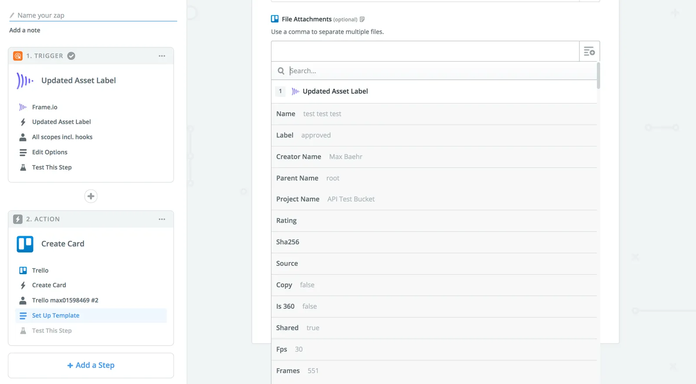
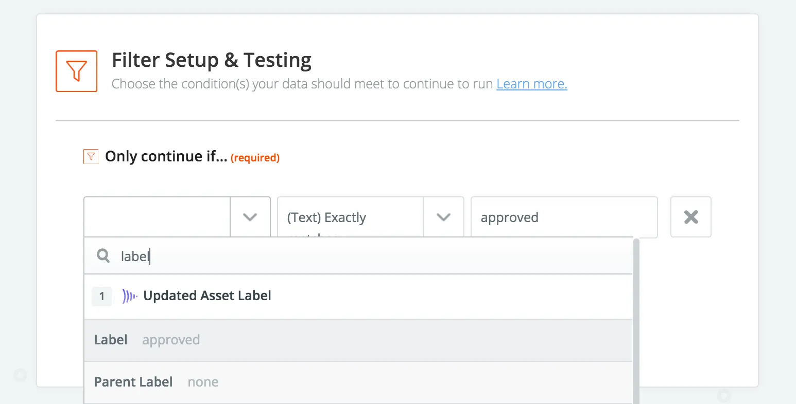

# Navigating resource data

Our API payloads are pretty comprehensive! That means (for example), when you’re catching a change to an Asset’s Status Label field, you may end up looking at a whole lot of fields, very few of which will be immediately relevant to you.

The good news is, Zapier’s data input fields all have a search function, and using that, you can quickly get to the field you need.

Of course, it’s also helpful if you know what to look for.

## What to look for

The following table is not exhaustive, but should give you a head start in building out workflows with Frame.io’s Zapier integration.

<Info>

**Asset URLs are long, and that's ok**

The Asset URLs you see in Frame.io’s API responses are direct links to Amazon S3. These URLs can and should be used in any Zapier app context where you want to move an Asset into another system. If you have a choice between “File Attachment” and “File Attachment (URL),” please choose the latter, as URL uploads in Zapier will generally support a wider range of file types and sizes.

</Info>

| Resource type | Field in Zapier | Description |
| --- | --- | --- |
| Asset(all) | Original | The original uploaded video, untouched. In most cases, this will be the key you want to push into other systems; but it will always be the original filetype, so may not be playable in all other contexts. |
| Asset (videos) | H264 *resolution* | All of Frame.io’s h.264 proxies are available on the Asset in Zapier. |
| Asset (image) | Image *quality* | Similar to h.264 video proxies, all proxies cut for images are also available in Zapier. |
| Asset (all) | Thumb | The Asset thumbnail as set in Frame.io. This field is great for adding visuals to project tracking systems like Trello or Airtable. |
| Asset (all) | Label | The Status Label. This field will usually be paired with a “Filter” action (similar to the screenshot about). |
| Asset (all) | Creator Email | The email address of the original uploader. |
| Asset (all) | Project ID | The ID of the Asset’s parent Project. This field is most useful when paired with the “Find Project” action, which you can use to fetch the Project’s name. |
| Asset (all) | Parent ID | The ID of an Asset’s parent, which will always be one of a folder, version stack, or Project root. |
| Comment | Text | The text of the comment. |
| Comment | Asset ID | The ID of the Comment’s parent Asset. Helpful for passing to the Find Asset action for additional context, or for linking in external tracking tools. |
| Comment | Owner Name | The first and last names of the user who left the Comment. |
| Comment | Owner Email | The email address of the user who left the Comment. |
| Project | Name | The name of the Project. |
