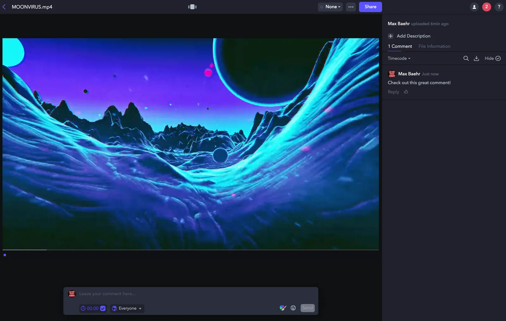
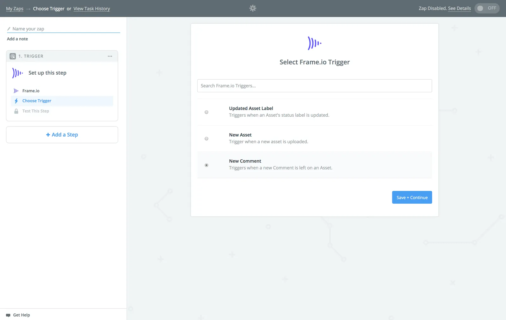
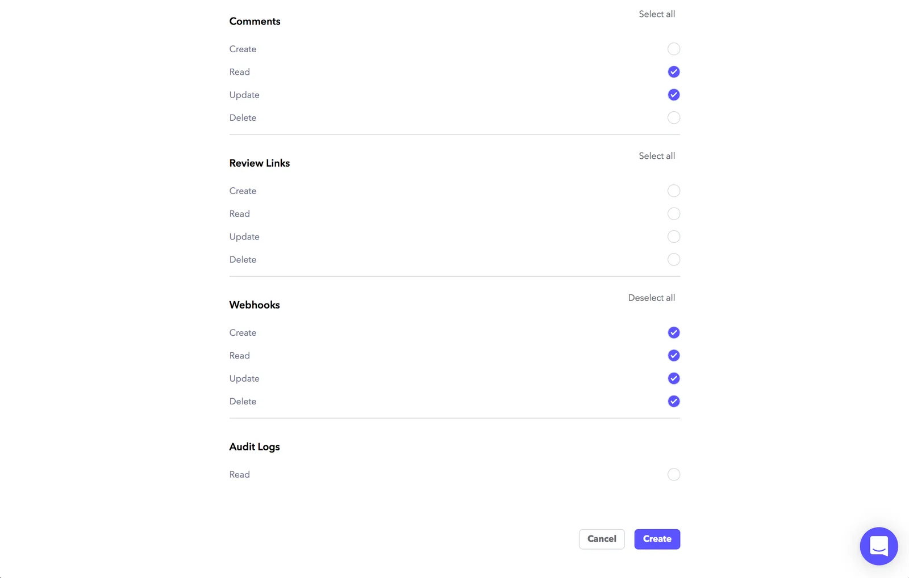
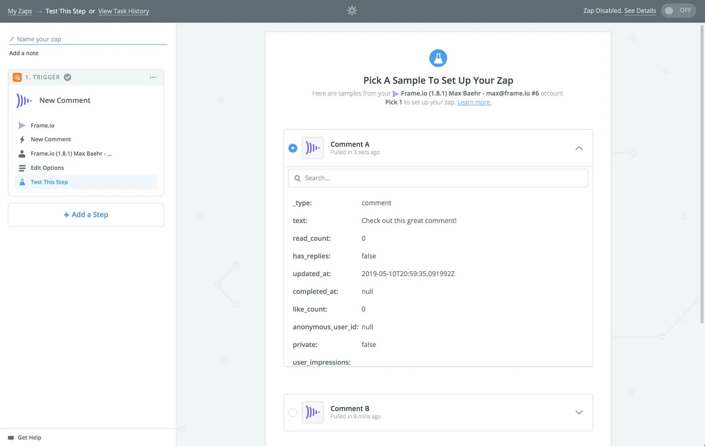
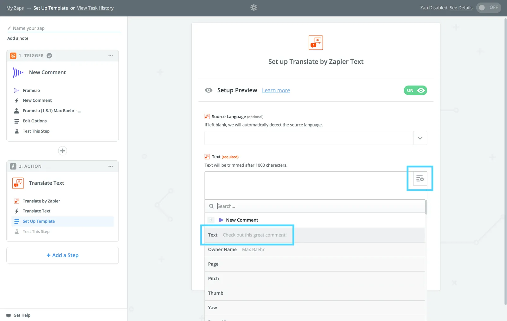
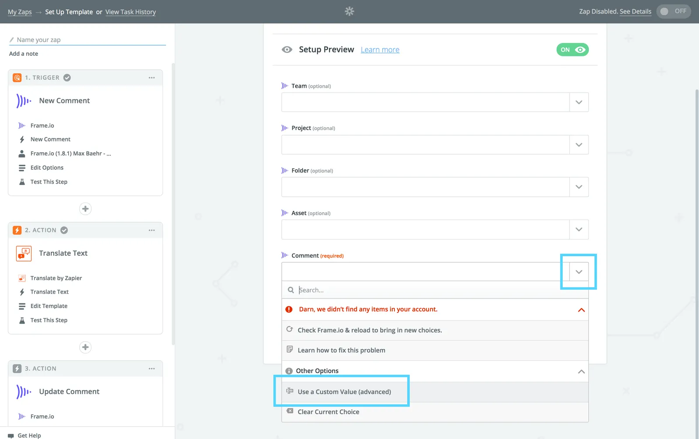
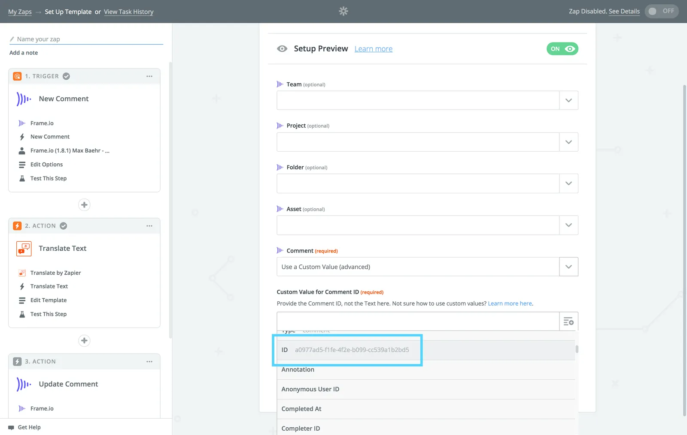
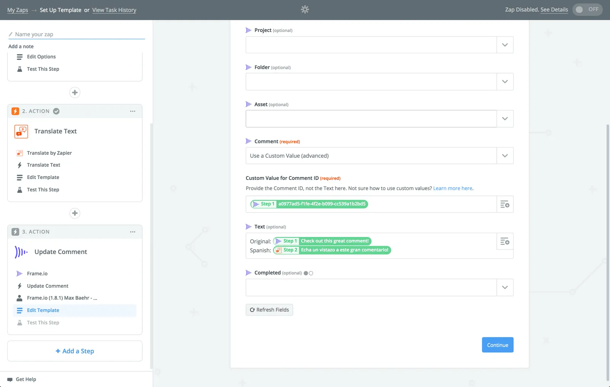
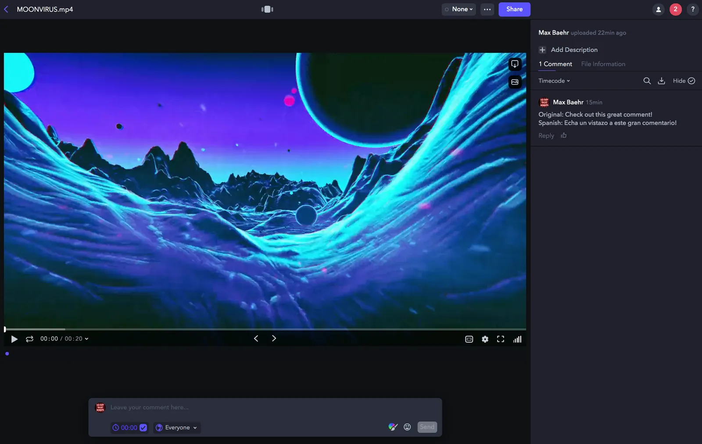
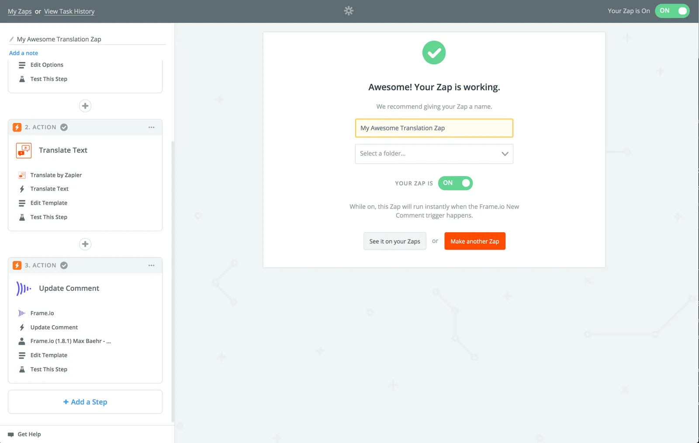

## Overview

In this guide, you’ll be using Frame.io’s [Zapier app](https://zapier.com/apps/frameio/) to “catch” Comments from Frame.io, and manipulate them using other apps in Zapier.

For the purposes of building a complete workflow, we’ll be following along with [this template](https://zapier.com/apps/frameio/integrations/frameio/47537/translate-frameio-comments-with-zapier) to enable automated translation of any Comment left on a Team in Frame.io.

You can start by using the template linked above, or you can start by creating a new Zap from scratch in Zapier. This guide will do the latter.

## Things you’ll need

Before you start, you’ll need three things:

1. Frame.io account access (so you can create an API Token)
2. Team Manager or Admin access to a Team in Frame.io (so you can create a Webhook)
3. A Zapier account (free is enough), and [Frame.io’s Zapier app](https://zapier.com/apps/frameio/integrations)

To verify the first two, head over to [developer.frame.io](/platform/v2) and sign in. If you don’t see the “Tokens” and “Webhooks” menu items (shown below), please reach out to your Frame.io account administrator.

## Tutorial

### 1. Upload a new Asset and make a Comment

Frame.io’s Zapier app relies on finding the most recent data, so if we’re going to be working with Comments, the best starting point is to open up Frame.io, upload a new Asset, and leave a Comment on it. Because Comments are strictly tied to their parent Assets, this will help Zapier make sure it’s pulling your most recent samples.

As a reminder, Zapier webhooks are specific to single Teams in Frame.io — so make sure your Comment is on an Asset that belongs to the Team where you’d like to install your workflow!

### 2. Connect your Frame.io account and fetch your Comment

Start by creating a new Zap by clicking the big, orange “Make a Zap” button on your Zapier Dashboard. Now, search for “Frame.io,” select the Frame.io app, and choose the “**New Comment**” Trigger.

In the next screen, if you haven’t yet connected a Frame.io account, you’ll need to generate an API Token and enter it.

### 2.5 Create an API Token

Head over to the [Frame.io Developer Portal](/platform/v2), sign in with your Frame.io account, and click on “Tokens” to create a new [API Token](https://developer.frame.io/tokens/new).

Give your new Token a descriptive name, and select the following scopes:

- **Accounts:** Read
- **Projects:** Read
- **Assets:** Read
- **Team:** Read, Update
- **Comment:** Create Read, Update
- **Webhooks:**  Create, Read, Update, Delete (all scopes)

When you’re done, click “**Create**,” and copy your Token. Now, go to Zapier, click “**Connect an Account**,” and enter your new token.

### 3. Select a Team and grab your sample Comment

After you’ve Saved with your newly connected Account, go ahead and pick a Team and Save.

Zapier will now search for “Samples” — at the top of which should be the Comment that you left in Step 1. Expand it to confirm, and if everything looks good, Save again.

### 4. Add your Translation Action

It’s time to add an Action to your Zap! Search for “Translate” and you should find the “**Translate by Zapier**” Action.

In the subsequent configuration screen, choose the icon in the upper right of the middle box, and pick the “Text” from your Trigger step. This will ensure that Zapier will always dynamically process the text for any new Comment that hits this Zap.

Now pick your language, Save, and Test.

If everything looks good, confirm and click “**Add a Step**.”

### 5. Update your Frame.io comment

Now that we have both the original and translated text, it’s time to rebuild our Comment!

Pick the Frame.io App, and choose the **Update Comment** Action.

At the bottom of the next screen, in the “Comment” field, click the dropdown and select “**Use a Custom Value**.” Then, pick the “**ID**” from your Trigger step. Similarly to the last step, this ensures that new Comments will always be handled dynamically.

Now, click “Refresh Fields,” and build out your dynamic Comment text using a combination of your original and translated text.

### 6. Test your Action

Once everything looks good, click “**Continue**,” then test your Action. This will send your translated Comment back to Frame.io.

Go to Frame.io, and if you see what you’re looking for, you’re all set!

### 6.5. Finishing up

Congrats! You’re done with the hard part!

To wrap up, click “**Finish**”, name your Zap, and turn it on! Now, any Comment you leave in this same Team will follow your workflow and be dynamically translated.

