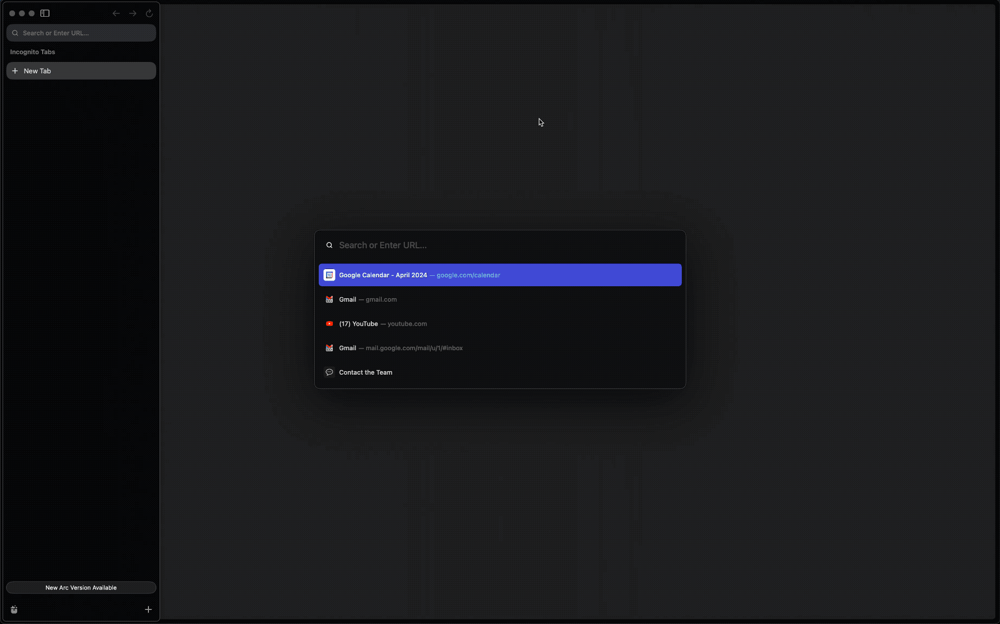
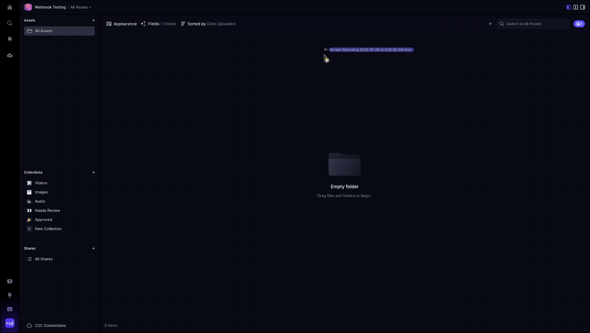

## O que é um webhook? {#what’s-a-webhook}

Um **webhook** é um callback HTTP do tipo push que o Frame.io dispara **assim que algo relevante acontece** na sua conta (por exemplo, um novo arquivo termina de ser transcodificado, um comentário é adicionado, um projeto é criado).
Em vez de consultar a API repetidamente (polling), você fornece uma URL HTTPS pública; o Frame.io envia um payload JSON para essa URL em tempo real para que você possa:

<CardGroup cols={2}>

<Card title="Sincronizar metadados com um DAM/MAM externo" icon="arrows-rotate" iconType="solid" />

<Card title="Alimentar canais do Slack ou sistemas de tickets" icon="bell" iconType="solid" />

</CardGroup>

Para saber mais sobre o que é um webhook e o que ele faz, consulte [https://docs.webhook.site/](https://docs.webhook.site/).

## Visão geral dos endpoints {#endpoint-overview}

| **Operação** | **Endpoint** | **Detalhes** |
| --- | --- | --- |
| **Criar** um webhook | POST /v4/accounts/\{account_id\}/workspaces/\{workspace_id\}/webhooks | Corpo com `name`, `url`, `events[]` |
| **Listar** todos os webhooks de um workspace | GET /v4/accounts/\{account_id\}/workspaces/\{workspace_id\}/webhooks | Suporta paginação |
| **Exibir** um webhook | GET /v4/webhooks/\{webhook_id\} | Retorna o segredo de assinatura apenas no momento da criação |
| **Atualizar** um webhook | PATCH /v4/webhooks/\{webhook_id\} | Altere `url`, `events` ou `is_active` |
| **Excluir** um webhook | DELETE /v4/webhooks/\{webhook_id\} | Interrompe as entregas imediatamente |

<Warning>

**Autenticação** — Todos os endpoints da V4 exigem um token de acesso OAuth 2.0 obtido pelo Adobe Developer Console. Tokens de desenvolvedor legados e JWTs **não** são aceitos.

</Warning>

## Mudanças e atualizações no Frame V4 {#changes-and-updates-in-frame-v4}

<Info>

Webhooks criados no Legacy são transferidos para a V4 com as seguintes mudanças:

1. **Estrutura do payload**: o Account ID foi adicionado ao payload
2. **Mudanças nos endpoints**: o `team_id` não é mais fornecido no payload JSON; em vez disso, ele está no parâmetro de caminho da URL: `https://api.frame.io/v4/accounts/:account_id/workspaces/:workspace_id/webhooks`
3. **Integração com a API**: devido a mudanças na estrutura da API, nos endpoints e nos métodos de autenticação, qualquer código existente para webhooks recebidos que faça chamadas subsequentes à API do Frame.io para enriquecimento e consulta de recursos precisa ser atualizado
4. **Tipos de evento**: os webhooks de asset foram divididos em eventos separados de File e Folder — quaisquer webhooks vindos do Legacy com eventos de asset precisam ser atualizados para usar os eventos de File e Folder apropriados

</Info>

<Warning>

**Status dos webhooks após a migração** — Quando sua conta migra para o Frame.io V4, os webhooks existentes de versões anteriores são desativados automaticamente. Isso garante que você possa modificar seus endpoints de webhook e a lógica da integração para funcionar com as atualizações da V4 antes de reativá-los. Webhooks que não foram atualizados para compatibilidade com a V4 encontrarão erros se forem ativados sem as modificações adequadas. Você pode verificar quais webhooks estão inativos examinando o campo `is_active` pela API ou revisando suas [configurações de webhook](https://next.frame.io/settings/webhooks) antes de reativá-los.

</Warning>

## Assinaturas de eventos de webhook {#webhook-event-subscriptions}

Ao criar e atualizar webhooks, identifique os eventos nos quais você tem interesse. Escolha quantos quiser, mas observe que a experiência é melhor se você assinar menos eventos, dividindo seus webhooks de forma lógica, com diferentes esquemas de nomenclatura e diferentes endpoints, para que você possa modelar sua lógica de negócios no lado receptor e fazer menos filtragem e roteamento em funções compartilhadas.

<Note>

Escopo dos eventos — Todos os eventos têm como escopo o Workspace informado durante a criação do webhook. Isso significa que os eventos serão enviados para ações realizadas em todos os projetos desse Workspace.

</Note>

### Projetos {#projects}

| Evento | Descrição |
| --- | --- |
| `project.created` | Um novo Project foi **criado** |
| `project.updated` | As configurações de um Project foram **atualizadas** |
| `project.deleted` | Um Project foi **excluído** |

### Arquivos {#files}

| Evento | Descrição |
| --- | --- |
| `file.created` | Um File foi **criado** no Frame.io. *Observação:* isso é disparado antes de o arquivo terminar de ser enviado. Se o seu handler precisar do arquivo completo, recomendamos escutar o evento `upload.completed` |
| `file.ready` | Todas as transcodificações foram **concluídas**, depois que um arquivo foi enviado e processado |
| `file.updated` | O nome ou outras informações de um File foram alterados |
| `file.deleted` | Um File foi **excluído** (manualmente ou não) |
| `file.upload.completed` | Um File foi **enviado** |
| `file.versioned` | Uma versão de File foi **criada** |

### Pastas {#folders}

| Evento | Descrição |
| --- | --- |
| `folder.created` | Uma nova Folder foi **criada** |
| `folder.updated` | As configurações de uma Folder foram **atualizadas** |
| `folder.deleted` | Uma Folder foi **excluída** |

### Comentários {#comments}

| Evento | Descrição |
| --- | --- |
| `comment.created` | Um novo comentário ou resposta foi **criado** |
| `comment.updated` | Um comentário foi atualizado |
| `comment.deleted` | Um comentário foi **excluído** |
| `comment.completed` | Um comentário foi marcado como **concluído** |
| `comment.uncompleted` | Um comentário foi marcado como **não concluído** |

### Metadados {#metadata}

| Evento | Descrição |
| --- | --- |
| `metadata.value.updated` | Campos de metadados atualizados para um asset |

### Collections {#collections}

| Evento | Descrição |
| --- | --- |
| `collection.created` | Uma nova Collection foi **criada** |
| `collection.updated` | Uma Collection foi **atualizada** |
| `collection.deleted` | Uma Collection foi **excluída** |

### Campos personalizados {#custom-fields}

| Evento | Descrição |
| --- | --- |
| `customfield.created` | Um novo campo personalizado foi **criado** |
| `customfield.updated` | Um campo personalizado foi **atualizado** |
| `customfield.deleted` | Um campo personalizado foi **excluído** |

### Compartilhamentos {#shares}

| Evento | Descrição |
| --- | --- |
| `share.created` | Um novo Share foi **criado** |
| `share.updated` | Um Share foi **atualizado** |
| `share.deleted` | Um Share foi **excluído** |
| `share.viewed` | Um Share foi **visualizado** |

## Payload da mensagem do webhook {#webhook-message-payload}

Todos os payloads de webhook contêm um campo `type`, que indica o evento ocorrido, e um objeto `resource`. O objeto `resource` contém o `type` e o `ID` do recurso do Frame.io relacionado ao evento.

### Exemplo de payload {#example-payload}

```json
{
  "account": {
    "id": "6f70f1bd-7e89-4a7e-b4d3-7e576585a181"
  },
  "project": {
    "id": "7e46e495-4444-4555-8649-bee4d391a997"
  },
  "resource": {
    "id": "d3075547-4e64-45f0-ad12-d075660eddd2",
    "type": "file"
  },
  "type": "file.ready",
  "user": {
    "id": "56556a3f-859f-4b38-b6c6-e8625b5da8a5"
  },
  "workspace": {
    "id": "378fcbf7-6f88-4224-8139-6a743ed940b2"
  }
}
```

No exemplo acima de um evento `file.created`, o `resource.id` indica o `ID` do File recém-criado. Além disso, são incluídos os objetos `workspace`, `project` e `user`, que contêm os respectivos `workspace.id`, `project.id` e `user.id`. Esses valores podem ser usados para reduzir chamadas à API, filtrando os eventos recebidos ou consultando dados armazenados em cache localmente.

<Warning>

**Não incluímos nenhuma informação adicional sobre o recurso assinado além do ID do recurso**.

Se a sua aplicação precisar de informações ou contexto adicionais, recomendamos fazer uma chamada à API para consultar mais informações sobre os recursos referenciados.

</Warning>

## Segurança {#security}

Por padrão, todos os webhooks têm uma chave de assinatura. Esse segredo de assinatura não configurável pode ser usado para verificar se a requisição se origina do Frame.io.

O payload de resposta do webhook que você configurou inclui o segredo de assinatura específico desse webhook. Esse segredo é **fornecido apenas nesta resposta inicial de criação do webhook**, portanto, armazene-o em um local seguro no seu armazenamento de segredos ou em variáveis de ambiente. Use-o depois para verificar se o webhook vem diretamente dos nossos servidores e não foi interceptado nem manipulado de forma alguma.

### Verificando assinaturas de webhook {#verifying-webhook-signatures}

Para proteger uma integração contra ataques man-in-the-middle e de repetição (replay), é essencial verificar a assinatura do payload do webhook. A verificação garante que os payloads de webhook foram realmente enviados pelo Frame.io e que o conteúdo do payload não foi modificado durante o transporte.

Os seguintes cabeçalhos HTTP são incluídos na requisição `POST`:

| Nome do cabeçalho | Descrição | Exemplo |
| --- | --- | --- |
| `X-Frameio-Request-Timestamp` | O timestamp em que a requisição foi enviada | `1604004499` |
| `X-Frameio-Signature` | A assinatura calculada do webhook | `v0=a77ce6856e609c884575c2fd211d07a9ad1c3f72e19c06ff710e8f086ffca883` |
| `user-agent: "Frame.io V4 API"` | User agent no cabeçalho para a V4 |  |
| `user-agent: "Frame.io Legacy API"` | User agent no cabeçalho para o Legacy |  |

```python title="Python"
import hmac
import hashlib

def verify_signature(curr_time, req_time, signature, body, secret):
    """
    Verify Webhook signature
    :Args:
        curr_time (float): Current epoch time
        req_time (float): Request epoch time
        signature (str): Signature provided by the Frame.io API for the given request
        body (str): Webhook body from the received POST
        secret (str): The secret for this Webhook that you saved when you first created it
    """
    if int(curr_time) - int(req_time) < 500:
        message = 'v0:{}:{}'.format(req_time, body)
        calculated_signature = 'v0={}'.format(hmac.new(
            bytes(secret, 'latin-1'),
            msg=bytes(message, 'latin-1'),
            digestmod=hashlib.sha256).hexdigest())
        if calculated_signature == signature:
            return True
    return False
```

**O timestamp** é a hora do sistema do Frame.io no momento em que o webhook de saída é enviado. Ele pode ser usado para evitar ataques de [repetição](https://en.wikipedia.org/wiki/Replay_attack). Recomendamos verificar se esse horário está dentro de 5 minutos do horário local.

**A assinatura** é um hash HMAC SHA256 gerado com a chave de assinatura fornecida quando o webhook é criado.

**Siga estas etapas para verificar a assinatura:**

<Steps>

<Step title="Extraia a assinatura">

Extraia a assinatura dos cabeçalhos HTTP.

</Step>

<Step title="Crie a mensagem a ser assinada">

Crie uma mensagem a ser assinada combinando a versão, o horário de entrega e o corpo da requisição: `v0:timestamp:body.`

</Step>

<Step title="Calcule o HMAC SHA256">

Calcule a assinatura HMAC SHA256 usando seu segredo de assinatura.

</Step>

<Step title="Compare as assinaturas">

Compare a assinatura calculada com a fornecida!

</Step>

</Steps>

<Note>

A assinatura fornecida tem o prefixo `v0=`. Atualmente, o Frame.io tem apenas essa versão para assinar requisições. Certifique-se de adicionar esse prefixo ao início da sua assinatura calculada.

</Note>

## Limites de taxa de webhooks {#webhook-rate-limits}

Os eventos de webhook e de Custom Action compartilham os seguintes limites por conta:

| Janela de tempo | Limite por conta |
| --- | --- |
| 1 minuto | 1.000 eventos |
| 1 hora | 20.000 eventos |

Ambos os limites se aplicam ao volume combinado de eventos de webhook e de Custom Action. Ficar dentro do limite por minuto não isenta a conta do limite por hora. Esses limites se aplicam no nível da conta, e não separadamente a cada assinatura de webhook ou Custom Action.

Esses são limites de volume de eventos, e não limites de requisições à API para criar, listar, atualizar ou excluir assinaturas de webhook ou Custom Actions.

<Warning>

Quando qualquer um dos limites no nível da conta é atingido, os eventos adicionais de webhook e de Custom Action são **descartados**, e não enfileirados para entrega posterior. Eventos descartados não são reenviados nem reproduzidos automaticamente quando houver capacidade disponível. A política de novas tentativas de entrega abaixo não se aplica a eventos descartados por limitação de taxa.

</Warning>

### Trabalhando dentro dos limites {#working-within-the-limits}

Para trabalhar dentro dos limites de webhook, recomendamos assinar apenas os **[eventos](#webhook-event-subscriptions)** de que sua integração precisa. Por exemplo, se o seu fluxo de trabalho começa quando um arquivo termina de ser enviado, assine `file.upload.completed` em vez de todos os eventos de arquivo. Revise regularmente as assinaturas da sua conta e remova as que não estiverem mais em uso.

Se a sua integração envia muitos arquivos ou faz uma série de atualizações, distribua essas operações ao longo do tempo sempre que possível para ficar dentro de ambos os limites e deixar capacidade para outras atividades da conta. Isso ajuda a evitar eventos descartados, que não são reenviados.

## Novas tentativas e registro em log {#retries-and-logging}

<CardGroup cols={2}>

<Card title="Política de novas tentativas de entrega" icon="arrows-rotate" iconType="solid">

- Três tentativas no total (inicial + 2 novas tentativas)
- Backoff exponencial começando em 15 s (+ jitter)
- Uma resposta HTTP `5xx`, um erro de conexão ou um timeout de mais de 5 segundos aciona uma nova tentativa
- Respostas HTTP `4xx`, incluindo `429`, não geram novas tentativas

</Card>

<Card title="Registro de falhas" icon="list" iconType="solid">

O Frame.io mantém um **log de falhas** com: `webhook_id`, `account_id`, `event_type`, `resource_id`, `user_id`.

</Card>

</CardGroup>

## Tutorial de webhooks {#webhook-tutorial}

### Etapa 1: configure o lado receptor (feito primeiro para que você saiba qual será sua URL) {#step-1-setup-receiving-end-done-first-so-that-you-know-what-your-url-will-be}

Aqui, estamos usando o [webhook.site](http://webhook.site/), que permite criar facilmente um receptor de webhook de uso único que pode ser usado para inspecionar payloads e enviar respostas básicas sem nenhuma lógica de negócios real. Quando você acessa [https://webhook.site](https://webhook.site/) pela primeira vez, um endpoint de webhook exclusivo é criado para você, e você pode copiá-lo imediatamente para usar.

Essa URL é exclusiva da sua sessão.

<Frame>



</Frame>

### Etapa 2: escolha o(s) evento(s) que deseja assinar {#step-2-choose-the-events-you-want-to-subscribe-to}

Neste tutorial, vamos manter as coisas simples e configurar este webhook para assinar apenas eventos `file.created`. O payload JSON que usaremos para criar o webhook será o seguinte.

```json
{
    "data": {
        "name": "asset.created sample webhook",
        "events": ["file.created"],
        "url": "https://webhook.site/c05f2216-9558-4816-bc09-f77ee7b9de40"
    }
}
```

### Etapa 3: crie um recurso de webhook usando o Postman {#step-3-create-a-webhook-resource-using-postman}

Usando o Postman, faça uma chamada à API para criar o recurso de webhook, informando o endpoint do [webhook.site](http://webhook.site/) no payload.

### Etapa 4: teste! {#step-4-test}

Agora que você criou a assinatura do webhook e tem um endpoint configurado para receber webhooks, é hora de testar disparando o primeiro webhook ao realizar a ação apropriada que o aciona!

Como nosso exemplo foi configurado para disparar com o gatilho `file.created`, vamos fazer upload de um novo asset em qualquer Project dentro da Account e do Workspace correspondentes em que o webhook foi configurado.

<Frame>



</Frame>

## Recursos adicionais {#additional-resources}

<CardGroup cols={2}>

<Card title="Ngrok" icon="globe" iconType="solid" href="https://ngrok.com/">

O **Ngrok** é uma ferramenta fantástica para desenvolvedores que trabalham com webhooks que precisam ser expostos em uma URL acessível publicamente. Ele cria túneis seguros do seu ambiente local para a internet, permitindo expor seu servidor local para receber payloads de webhook em tempo real.

</Card>

<Card title="Hookdeck" icon="webhook" iconType="solid" href="https://hookdeck.com/">

O **Hookdeck** é uma plataforma criada para ajudar equipes a gerenciar webhooks de forma confiável, oferecendo um gateway de eventos robusto. Ele centraliza o tratamento de webhooks, garantindo que nenhum evento seja perdido, e oferece recursos como filtragem, enfileiramento e novas tentativas de webhooks com falha.

</Card>

</CardGroup>

<CardGroup cols={2}>

<Card title="Webhook.site" icon="webhook" iconType="solid" href="https://webhook.site">

O **Webhook.site** é uma excelente ferramenta para prototipar e testar webhooks, oferecendo uma plataforma simples e poderosa para capturar e inspecionar requisições HTTP enviadas para URLs exclusivas geradas automaticamente.

</Card>

<Card title="Val.town" icon="code" iconType="solid" href="https://www.val.town/">

O **Val.town** é uma excelente ferramenta para prototipar rapidamente handlers de webhook, pois simplifica o processo de escrever, testar e implantar pequenas funções JavaScript e Python diretamente no navegador.

</Card>

</CardGroup>
